Today you'll publish the orders of our tech shop as an MCP server, with two tools, a resource, and a prompt.

And instead of an AI client, we'll talk to it with plain curl, so you see the protocol itself.

It's lab 5.2 of my free **Spring AI: Novice to Expert** course, where every lesson has a concept part and a hands-on lab, and everything runs on a free local model with Ollama.

🎥 **Prefer video?** Watch the full tutorial here:

{VIDEO}

## What we'll build

The server starter. Two tools. A resource and a prompt. Then we initialize a session, and call everything with curl.

1. **The server starter**: Streamable HTTP on /mcp
2. **Publish tools**: find_order, cancel_order
3. **A resource and a prompt**: Return policy, email template
4. **Initialize a session**: The JSON-RPC handshake
5. **Call everything**: List, call, read, get

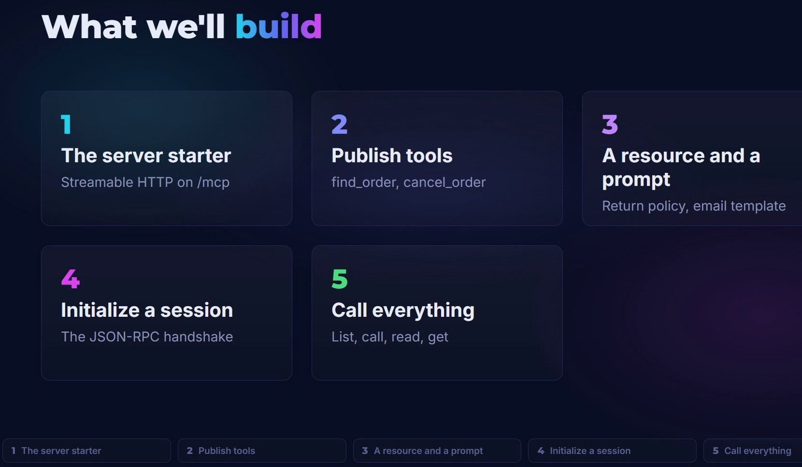

## Step 1: The server starter

On start.spring.io: Spring Web, and Model Context Protocol Server. That's all. No chat model: a server doesn't need one.

**pom.xml**

- **spring-boot-starter-webmvc**: the web server
- **spring-ai-starter-mcp-server-webmvc**: the MCP server

In the properties: port 8081, a name, a version, and instructions for clients. I start it, and call `/mcp`.

**`application.properties`** (`src/main/resources/application.properties`):

```properties
spring.application.name=order-mcp-server
server.port=8081

spring.ai.mcp.server.name=order-server
spring.ai.mcp.server.version=1.0.0
spring.ai.mcp.server.instructions=Tools and data for the orders of a tech shop.
```

```bash
$ curl -i -X POST localhost:8081/mcp
HTTP/1.1 404
```

404! In this version, the server starts the older SSE transport by default. Look: `/sse` answers.

```bash
$ curl localhost:8081/sse
event:endpoint
data:/mcp/message?sessionId=ec92911c-...
```

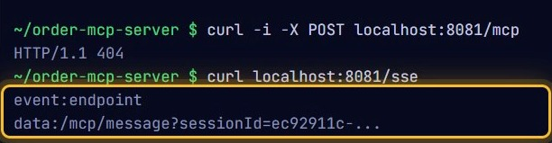

So I set the protocol to STREAMABLE, the current transport. Now the endpoint is `/mcp`.

**`application.properties`** (`src/main/resources/application.properties`):

```properties
spring.application.name=order-mcp-server
server.port=8081

spring.ai.mcp.server.name=order-server
spring.ai.mcp.server.version=1.0.0
spring.ai.mcp.server.protocol=STREAMABLE
spring.ai.mcp.server.instructions=Tools and data for the orders of a tech shop.
```

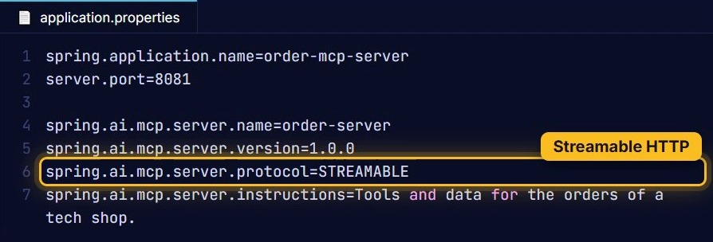

## Step 2: Publish tools

The Order record and the repository are the same as in lab 3.1: three orders in a map.

**`OrderRepository.java`** (`src/main/java/dev/course/orders/OrderRepository.java`):

```java
package dev.course.orders;

import java.time.LocalDate;
import java.util.Map;
import java.util.Optional;
import java.util.concurrent.ConcurrentHashMap;

import org.springframework.stereotype.Repository;

@Repository
public class OrderRepository {

    // In a real app, this is your database
    private final Map<String, Order> orders = new ConcurrentHashMap<>(Map.of(
            "A-1001", new Order("A-1001", "Wireless headphones", "SHIPPED", LocalDate.of(2026, 11, 20)),
            "A-1002", new Order("A-1002", "4K monitor", "PROCESSING", LocalDate.of(2026, 11, 27)),
            "A-1003", new Order("A-1003", "Mechanical keyboard", "DELIVERED", LocalDate.of(2026, 11, 12))));

    public Optional<Order> find(String id) {
        return Optional.ofNullable(orders.get(id));
    }

    public void save(Order order) {
        orders.put(order.id(), order);
    }
}
```

OrderMcpServer is a normal Spring component. find order is published with McpTool, and its parameter with McpToolParam.

**`OrderMcpServer.java`**:

```java
package dev.course.orders;

import org.slf4j.Logger;
import org.slf4j.LoggerFactory;
import org.springframework.ai.mcp.annotation.McpArg;
import org.springframework.ai.mcp.annotation.McpPrompt;
import org.springframework.ai.mcp.annotation.McpResource;
import org.springframework.ai.mcp.annotation.McpTool;
import org.springframework.ai.mcp.annotation.McpToolParam;
import org.springframework.stereotype.Component;

import io.modelcontextprotocol.spec.McpSchema.PromptMessage;
import io.modelcontextprotocol.spec.McpSchema.Role;
import io.modelcontextprotocol.spec.McpSchema.TextContent;

@Component
public class OrderMcpServer {

    private static final Logger log = LoggerFactory.getLogger(OrderMcpServer.class);

    private final OrderRepository repository;

    public OrderMcpServer(OrderRepository repository) {
        this.repository = repository;
    }

    // TOOL: an action the model can call
    @McpTool(name = "find_order", description = "Find an order by its id. Returns null if it doesn't exist.",
            annotations = @McpTool.McpAnnotations(readOnlyHint = true, destructiveHint = false))
    public Order findOrder(@McpToolParam(description = "The order id, like A-1001") String id) {
        log.info("TOOL find_order({})", id);
        return repository.find(id).orElse(null);
    }
```

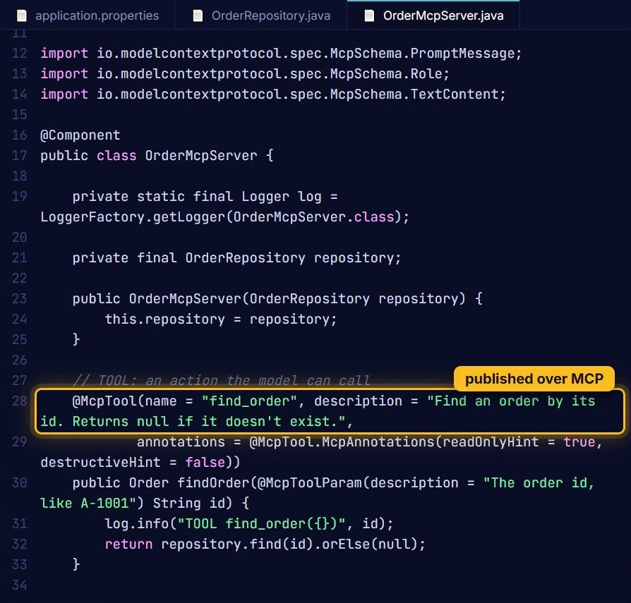

It only reads, so I add the hints: read only, not destructive. Without them, Spring AI marks every tool as destructive.

Cancel order changes data. Its rule is checked in Java: only orders in processing can be cancelled. And it returns a clear message.

**`OrderMcpServer.java`** (continued):

```java
    @McpTool(name = "cancel_order", description = "Cancel an order. Only orders in PROCESSING can be cancelled.")
    public String cancelOrder(@McpToolParam(description = "The order id") String id) {
        log.info("TOOL cancel_order({})", id);
        Order order = repository.find(id).orElse(null);
        if (order == null) {
            return "No order " + id;
        }
        if (!order.status().equals("PROCESSING")) {   // the rule is checked in Java, not by the model
            return "Order " + id + " is " + order.status() + " and can't be cancelled";
        }
        repository.save(new Order(id, order.product(), "CANCELLED", order.deliveryDate()));
        return "Order " + id + " is cancelled";
    }
```

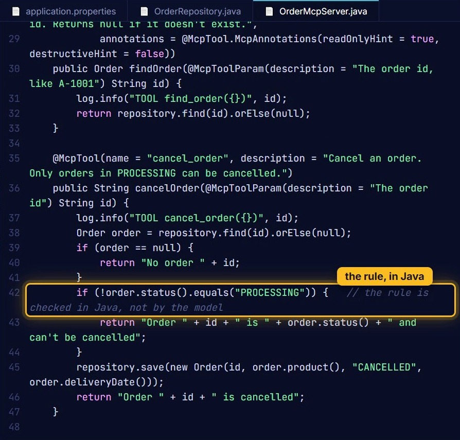

## Step 3: A resource and a prompt

McpResource publishes the return policy, as Markdown, under a URI.

**`OrderMcpServer.java`** (continued):

```java
    // RESOURCE: data the client application can read
    @McpResource(uri = "orders://policies/returns", name = "return-policy",
            description = "The shop's return policy", mimeType = "text/markdown")
    public String returnPolicy() {
        return """
                # Return policy
                - Return any item within 30 days for a full refund.
                - Opened headphones can't be returned, for hygiene reasons.
                """;
    }
```

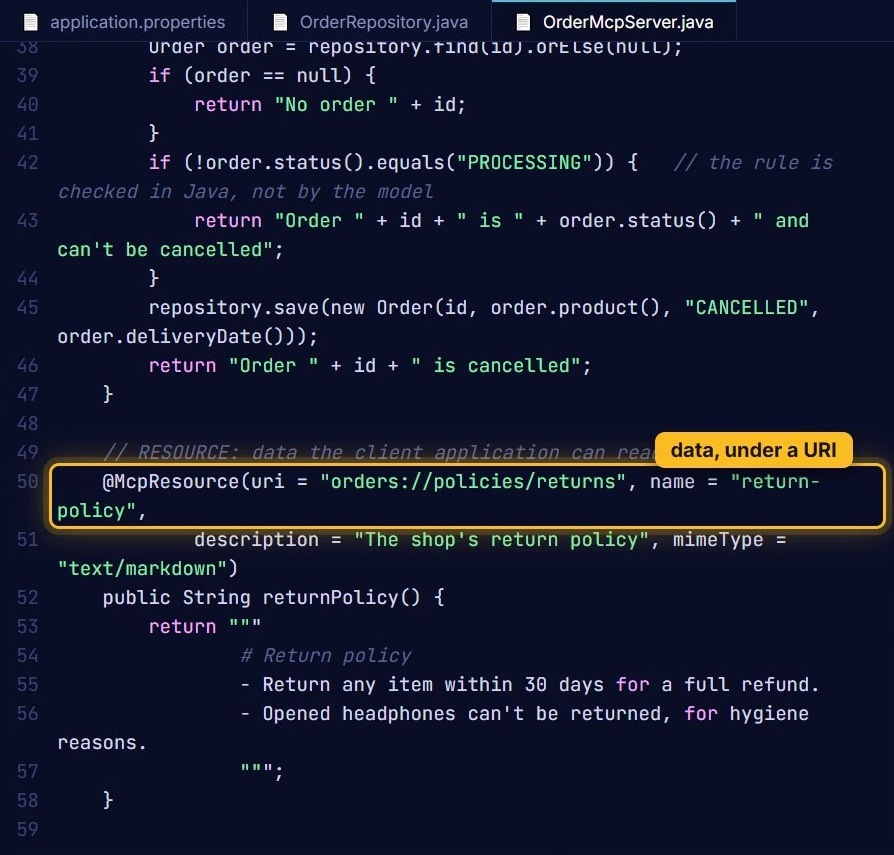

McpPrompt publishes a template, with one argument: the order id. It returns a PromptMessage with the user role.

**`OrderMcpServer.java`** (continued):

```java
    // PROMPT: a reusable prompt template the user can pick
    @McpPrompt(name = "order-update-email", description = "Write an email to a customer about their order")
    public PromptMessage orderUpdateEmail(@McpArg(name = "orderId", description = "The order id", required = true) String orderId) {
        return new PromptMessage(Role.USER, new TextContent("Use find_order to look up order " + orderId
                + ", then write a short, friendly email to the customer about its status and delivery date."));
    }
}
```

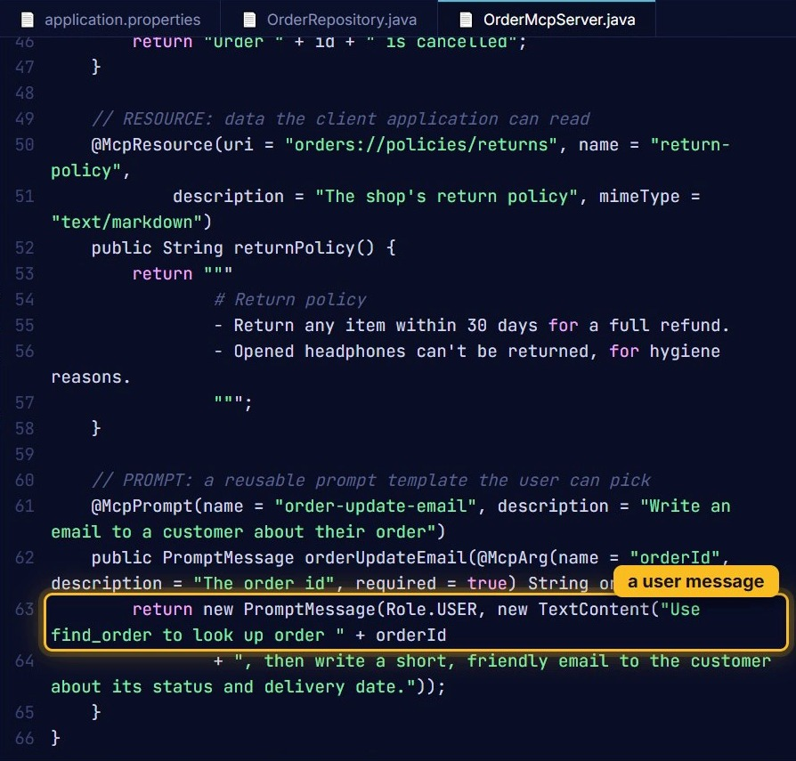

I restart. The log confirms it: two tools, one resource, one prompt.

```bash
$ ./mvnw spring-boot:run
...
Registered tools: 2
Registered resources: 1
Registered prompts: 1
Started OrderMcpServerApplication in 2.3 seconds
```

## Step 4: Initialize a session

The client sends initialize, with its protocol version and its name.

```bash
$ curl -i localhost:8081/mcp -H "Content-Type: application/json" -H "Accept: application/json, text/event-stream" -d '{"jsonrpc":"2.0","id":0,"method":"initialize","params":{"protocolVersion":"2025-06-18","capabilities":{},"clientInfo":{"name":"curl","version":"1.0"}}}'
HTTP/1.1 200
Mcp-Session-Id: 42f1de7d-01ed-45f1-8512-f9df0bd0866a
Content-Type: application/json

{"jsonrpc":"2.0","id":0,"result":{"protocolVersion":"202
5-06-18","capabilities":{..."prompts":{"listChanged":tru
e},"resources":{...},"tools":{"listChanged":true}},"serv
erInfo":{"name":"order-server","version":"1.0.0"},"instr
uctions":"Tools and data for the orders of a tech
shop."}}
```

The server answers with its capabilities, its name, and our instructions. And a session id, in a header. Every next request must send it.

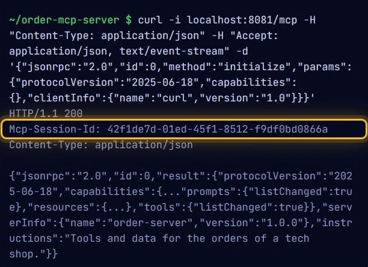

Typing this every time is painful. So the project has a tiny script, `mcp.sh`. It initializes once, keeps the session id, and sends one request.

**`mcp.sh`** (`mcp.sh`):

```bash
#!/usr/bin/env bash
# Send one MCP request with curl.  usage: ./mcp.sh <method> ['<params as JSON>']
# Example: ./mcp.sh tools/call '{"name":"find_order","arguments":{"id":"A-1001"}}'
URL=http://localhost:8081/mcp
H=(-H "Content-Type: application/json" -H "Accept: application/json, text/event-stream")

# 1. Initialize once, and keep the session id the server returns
if [ ! -f .mcp-session ]; then
  curl -s -D - -o /dev/null "${H[@]}" "$URL" \
    -d '{"jsonrpc":"2.0","id":0,"method":"initialize","params":{"protocolVersion":"2025-06-18","capabilities":{},"clientInfo":{"name":"curl","version":"1.0"}}}' \
    | grep -i '^mcp-session-id' | cut -d' ' -f2 | tr -d '\r' > .mcp-session
  curl -s "${H[@]}" -H "Mcp-Session-Id: $(cat .mcp-session)" "$URL" -d '{"jsonrpc":"2.0","method":"notifications/initialized"}'
fi

# 2. Send the request in that session, and print the JSON answer
curl -s "${H[@]}" -H "Mcp-Session-Id: $(cat .mcp-session)" "$URL" \
  -d "{\"jsonrpc\":\"2.0\",\"id\":1,\"method\":\"$1\",\"params\":${2:-"{}"}}" | sed -n 's/^data://p'
echo
```

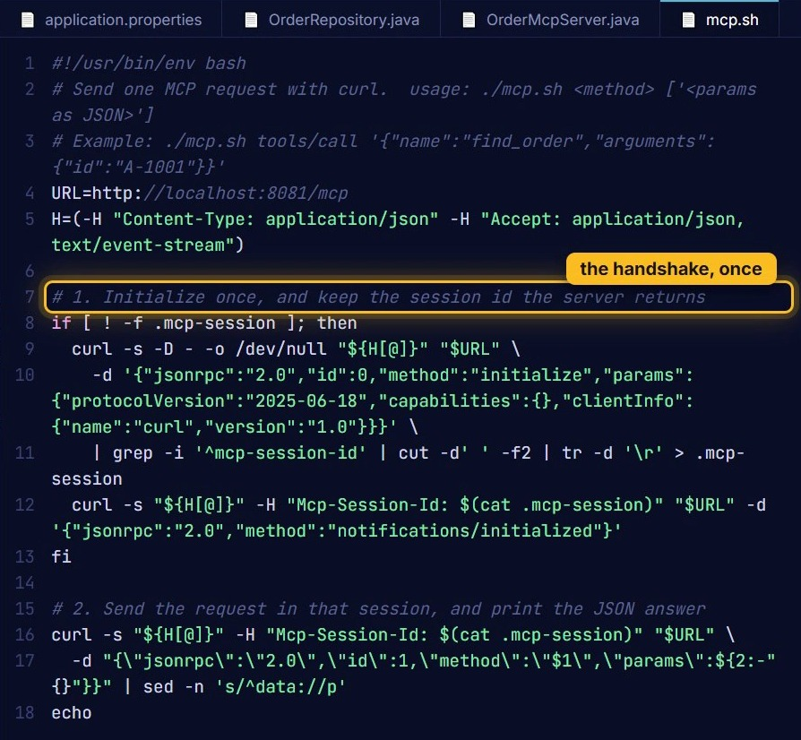

## Step 5: Call everything

`tools/list` returns both tools, with their JSON schema, and their hints. find order is read only. cancel order is destructive.

```bash
$ ./mcp.sh tools/list
{"jsonrpc":"2.0","id":1,"result":{"tools":[{"name":"canc
el_order","description":"Cancel an order. Only orders in
PROCESSING can be cancelled.", "inputSchema":{...},"anno
tations":{..."readOnlyHint":false,"destructiveHint":true
,...}},
{"name":"find_order","description":"Find an order by its
id. Returns null if it doesn't exist.", "inputSchema":{.
.."properties":{"id":{"type":"string","description":"The
order id, like A-1001"}},"required":["id"]},"annotations
":{..."readOnlyHint":true,"destructiveHint":false,...}}]
}}
```

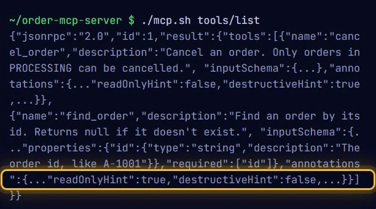

`tools/call`, with find order and an id. The result is our Order record, as JSON text.

```bash
$ ./mcp.sh tools/call '{"name":"find_order","arguments":{"id":"A-1001"}}'
{"jsonrpc":"2.0","id":1,"result":{"content":[{"type":"te
xt","text":"{\"id\":\"A-1001\",\"product\":\"Wireless he
adphones\",\"status\":\"SHIPPED\",\"deliveryDate\":\"202
6-11-20\"}"}],"isError":false}}
```

`resources/read`, with the URI: the return policy. And `prompts/get`: the template, filled with order A-1002.

```bash
$ ./mcp.sh resources/read '{"uri":"orders://policies/returns"}'
{"jsonrpc":"2.0","id":1,"result":{"contents":[{"uri":"or
ders://policies/returns","mimeType":"text/markdown","tex
t":"# Return policy\n- Return any item within 30 days
for a full refund.\n- Opened headphones can't be
returned, for hygiene reasons.\n"}]}}
```

```bash
$ ./mcp.sh prompts/get '{"name":"order-update-email","arguments":{"orderId":"A-1002"}}'
{"jsonrpc":"2.0","id":1,"result":{"messages":[{"role":"u
ser","content":{"type":"text","text":"Use find_order to
look up order A-1002, then write a short, friendly email
to the customer about its status and delivery
date."}}]}}
```

Now the rule. Cancel A-1001: it's shipped, so Java refuses. Cancel A-1002: it's processing, so it works.

```bash
$ ./mcp.sh tools/call '{"name":"cancel_order","arguments":{"id":"A-1001"}}'
{"jsonrpc":"2.0","id":1,"result":{"content":[{"type":"te
xt","text":"Order A-1001 is SHIPPED and can't be
cancelled"}],"isError":false}}
```

```bash
$ ./mcp.sh tools/call '{"name":"cancel_order","arguments":{"id":"A-1002"}}'
{"jsonrpc":"2.0","id":1,"result":{"content":[{"type":"te
xt","text":"Order A-1002 is
cancelled"}],"isError":false}}
```

And an order that doesn't exist? The text is just: null. It works, but a clear message would help the model, and the user. Remember that for the challenge.

```bash
$ ./mcp.sh tools/call '{"name":"find_order","arguments":{"id":"A-9999"}}'
{"jsonrpc":"2.0","id":1,"result":{"content":[{"type":"te
xt","text":"null"}],"isError":false}}
```

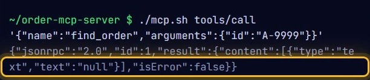

## 3 pro tips

Test your server with curl, or the MCP Inspector, before any AI touches it. If the protocol is wrong, the model can't help.

Set the hints honestly. Clients use them to ask the user before destructive actions.

And log every tool call on the server. It's the only side that sees every client.

- **Test without AI first**: curl or the MCP Inspector
- **Honest hints**: Clients ask before destructive calls
- **Log on the server**: It sees every client

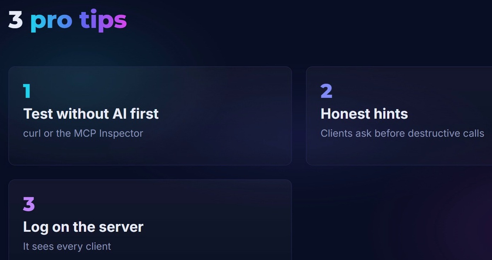

## Your challenge

Your challenge: make find order return a clear message for an unknown order, instead of null.

Then add a resource with a URI template, `orders://{id}`, that returns one order. Read it with `mcp.sh`.

- **No more null**: "No order A-9999"
- **A resource template**: orders://{id} → one order

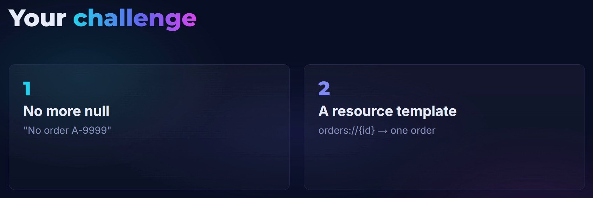

## Recap

- `protocol=STREAMABLE`: the endpoint is **/mcp**
- `@McpTool` + **hints**, `@McpResource`, `@McpPrompt`
- A session: **initialize**, then list and call

## Get the code and the quiz

- **Code for this lab**: https://github.com/NEDBS12/youtube-tuto/tree/main/spring-ai-course/labs/order-mcp-server
- **All course code, quizzes and resources**: https://github.com/NEDBS12/youtube-tuto/tree/main/spring-ai-course
- **Lesson quiz and section evals**: https://nedbs12.github.io/youtube-tuto/spring-ai-course/quiz/
- **Spring AI MCP server docs**: https://docs.spring.io/spring-ai/reference/api/mcp/mcp-server-boot-starter-docs.html
- **Model Context Protocol**: https://modelcontextprotocol.io
- **Spring AI reference docs**: https://docs.spring.io/spring-ai/reference/

🎥 **Watch the video tutorial:** {VIDEO_URL}

**Previous: Lesson 5.2, build an MCP server. Next: Lesson 5.3, MCP security.**

*The editor and terminal in the screenshots are a simplified recreation; the code and the outputs come from real runs of the lab.*

*I'm Zero Cost AI: I build AI tools and tutorials and share them for free. Follow me on Medium for the next lessons, and subscribe on YouTube: https://www.youtube.com/@zerocostai-f1h*
