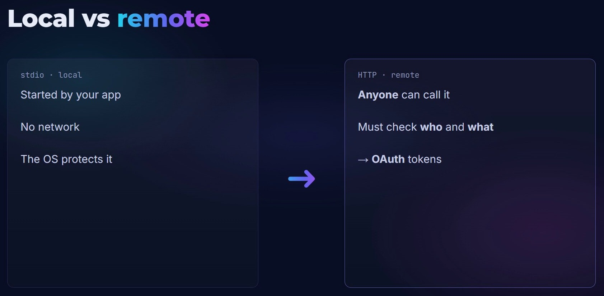
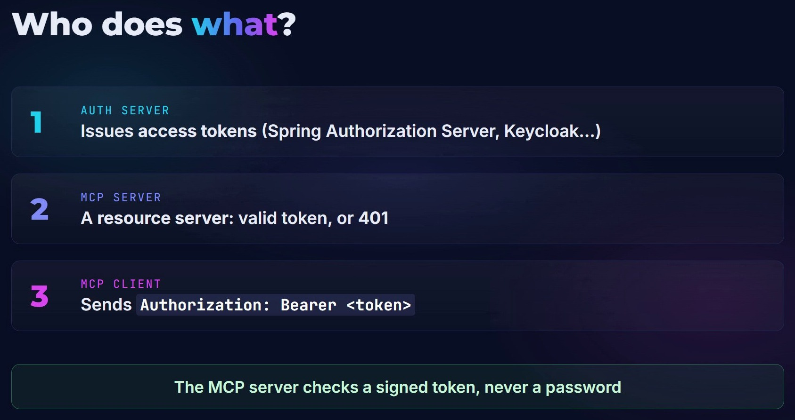
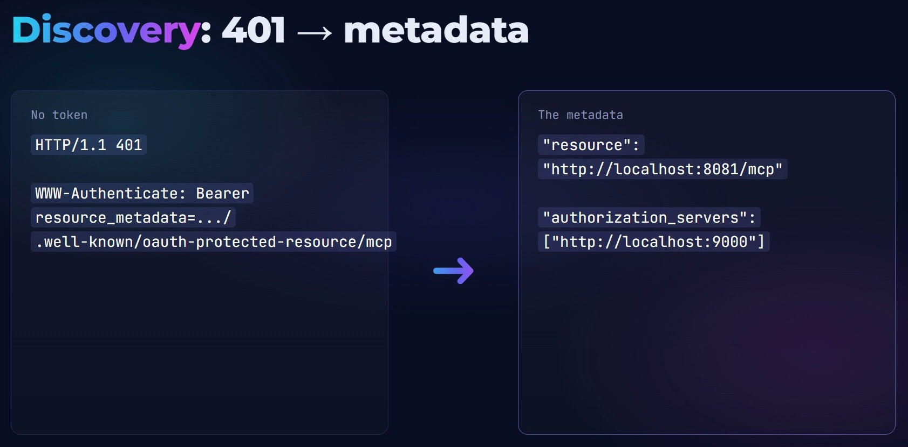
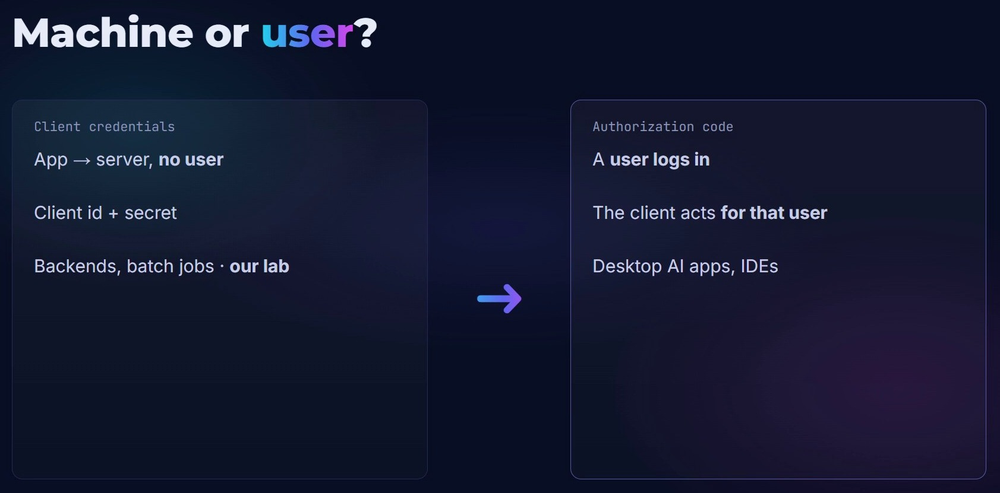
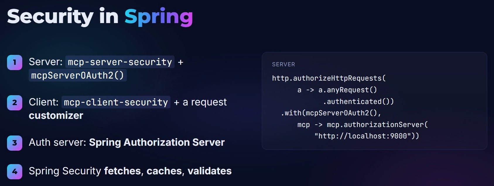
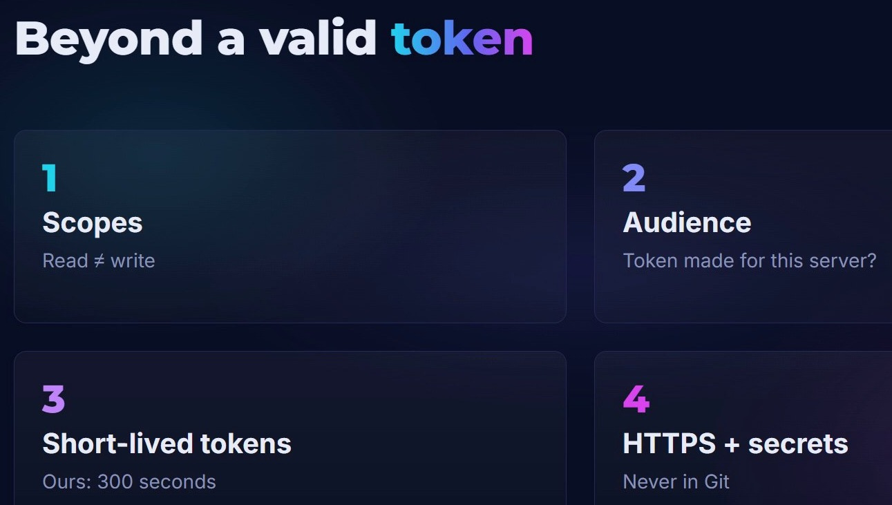

Our order server from the last lab has a problem. Anyone who can reach port 8081 can cancel orders. No password, no token, nothing.

In this lesson: how MCP security works, with OAuth 2, and how Spring secures both the server and the client.

It's lesson 5.3 of my free **Spring AI: Novice to Expert** course, where every lesson has a concept part and a hands-on lab, and everything runs on a free local model with Ollama.

🎥 **Prefer video?** Watch the full tutorial here:

{VIDEO}

## Local vs remote

First: when do you need it?

A local stdio server runs on your machine, started by your app. There's no network, so your operating system is the security.

A Streamable HTTP server is on the network. Any program can call it. So it must check who is calling, and what they're allowed to do. The MCP specification uses OAuth for this.

### stdio · local

- Started by your app
- No network
- The OS protects it

### HTTP · remote

- **Anyone** can call it
- Must check **who** and **what**
- → **OAuth** tokens



## Who does what?

Three players.

The authorization server issues access tokens. It knows the clients and their secrets. It can be Spring Authorization Server, Keycloak, Okta, and others.

The MCP server is a resource server. It accepts a request only with a valid token, signed by that authorization server.

The MCP client gets a token first, then sends it in every request, in the Authorization header: Bearer, and the token.

The MCP server never sees a password. It only checks a signed token.

- **Auth server**: Issues **access tokens** (Spring Authorization Server, Keycloak...)
- **MCP server**: A **resource server**: valid token, or **401**
- **MCP client**: Sends `Authorization: Bearer <token>`

**The MCP server checks a signed token, never a password**



## Discovery: 401 → metadata

How does a client know where to get a token? MCP defines a discovery flow. Here's real output from our lab.

Without a token, the server answers 401, with a header that points to its metadata.

The metadata lists the authorization servers it trusts. A smart client follows that path automatically.

### No token

- `HTTP/1.1 401`
- `WWW-Authenticate: Bearer`
`resource_metadata=.../`
`.well-known/oauth-protected-resource/mcp`

### The metadata

- `"resource":`
`"http://localhost:8081/mcp"`
- `"authorization_servers":`
`["http://localhost:9000"]`



## Machine or user?

Two kinds of clients.

Client credentials: a backend app talks to the server for itself, with its own id and secret. No user involved. That's our lab.

Authorization code: a user logs in, in a browser, and the client acts on behalf of that user. That's what desktop AI apps do, so each user only sees their own data.

### Client credentials

- App → server, **no user**
- Client id + secret
- Backends, batch jobs · **our lab**

### Authorization code

- A **user logs in**
- The client acts **for that user**
- Desktop AI apps, IDEs



## Security in Spring

In Spring, three pieces.

The server: the Spring AI community library, MCP server security, and one line in the security filter chain, with the authorization server's address.

The client: MCP client security. A request customizer gets a token, and adds it to every MCP request.

The authorization server: Spring Authorization Server. The client is just a few properties.

Spring Security does the token work: fetching, caching, validating signatures.

- Server: `mcp-server-security` + `mcpServerOAuth2()`
- Client: `mcp-client-security` + a request **customizer**
- Auth server: **Spring Authorization Server**
- Spring Security **fetches**, **caches**, **validates**

In code:

```java
http.authorizeHttpRequests(
      a -> a.anyRequest()
            .authenticated())
  .with(mcpServerOAuth2(),
      mcp -> mcp.authorizationServer(
          "http://localhost:9000"))
```



## Beyond a valid token

A valid token is only the start. Four more things for production.

Scopes: separate reading from writing. A reporting app shouldn't be able to cancel orders.

Audience: check that the token was made for this server. In our lab, the token's audience is the client's own id, and the server doesn't check it. That's fine for a demo, not for production.

Short-lived tokens: ours expire after five minutes. Spring fetches a new one when needed.

And HTTPS, and secrets in a vault or environment variables, never in Git.

- **Scopes**: Read ≠ write
- **Audience**: Token made for this server?
- **Short-lived tokens**: Ours: 300 seconds
- **HTTPS + secrets**: Never in Git



## Recap

- Remote MCP servers need **OAuth**: token or **401**
- Auth server issues, client **sends**, MCP server **validates**
- Then scopes, audience, short tokens, HTTPS

## Quick quiz

Test yourself before you read the answers.

1. **Role**: In MCP security, what is the MCP server?
2. **Header**: How does the client send its token?
3. **Grant**: A backend app, no user. Which grant type?

**Answers:**

1. A **resource server**
2. `Authorization: Bearer <token>`
3. **Client credentials**

The full five-question quiz for this lesson is free on the course quiz page: https://nedbs12.github.io/youtube-tuto/spring-ai-course/quiz/

## Get the code and the quiz

- **Lab code for this lesson**: https://github.com/NEDBS12/youtube-tuto/tree/main/spring-ai-course/labs/secure-order-server
- **All course code, quizzes and resources**: https://github.com/NEDBS12/youtube-tuto/tree/main/spring-ai-course
- **Lesson quiz and section evals**: https://nedbs12.github.io/youtube-tuto/spring-ai-course/quiz/
- **Spring AI MCP security docs**: https://docs.spring.io/spring-ai/reference/api/mcp/mcp-security.html
- **MCP security library (Spring AI community)**: https://github.com/spring-ai-community/mcp-security
- **Spring AI reference docs**: https://docs.spring.io/spring-ai/reference/

🎥 **Watch the video tutorial:** {VIDEO_URL}

**Previous: Lab 5.2. Next: Lab 5.3, a secure MCP client and server pair.**

*I'm Zero Cost AI: I build AI tools and tutorials and share them for free. Follow me on Medium for the next lessons, and subscribe on YouTube: https://www.youtube.com/@zerocostai-f1h*
