3, the last lab of section five. Today you'll lock down our order server with OAuth 2, and connect an AI client that gets its own token.

Three Spring Boot apps, working together.

It's lab 5.3 of my free **Spring AI: Novice to Expert** course, where every lesson has a concept part and a hands-on lab, and everything runs on a free local model with Ollama.

🎥 **Prefer video?** Watch the full tutorial here:

{VIDEO}

## Three apps, one flow

Here's the setup.

An authorization server, on port 9000. It knows one client: our AI app.

The order MCP server from lab 5.2, on port 8081, now protected.

And an AI client, on port 8080, with Qwen. It gets a token, and uses the order tools.

Five steps: the authorization server, the lock, a curl test, the client, and the AI.

- **:9000**: **auth-server**: issues tokens
- **:8081**: **secure-order-server**: MCP server, token required
- **:8080**: **secure-order-client**: Qwen + MCP client + token

**Client credentials: a backend app, no user login**

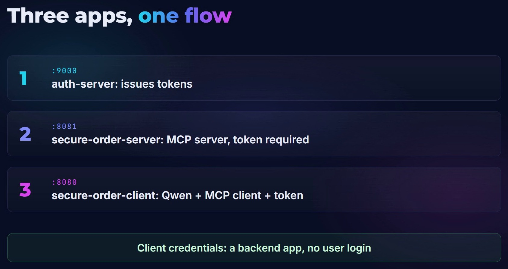

## Step 1: The authorization server

A new project, with one dependency: OAuth 2 Authorization Server. No Java code at all.

**`application.properties`** (`auth-server/src/main/resources/application.properties`):

```properties
spring.application.name=auth-server
server.port=9000

# One machine-to-machine client: our AI app
spring.security.oauth2.authorizationserver.client.order-client.registration.client-id=order-client
spring.security.oauth2.authorizationserver.client.order-client.registration.client-secret={noop}order-secret
spring.security.oauth2.authorizationserver.client.order-client.registration.client-authentication-methods=client_secret_basic
spring.security.oauth2.authorizationserver.client.order-client.registration.authorization-grant-types=client_credentials
spring.security.oauth2.authorizationserver.client.order-client.registration.scopes=orders
```

In the properties, one client: order client, with a secret, the client credentials grant, and one scope: orders.

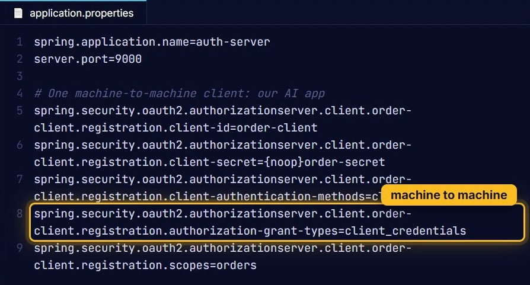

The noop prefix means: the secret is stored as plain text. Fine for a demo. In production, store a hash.

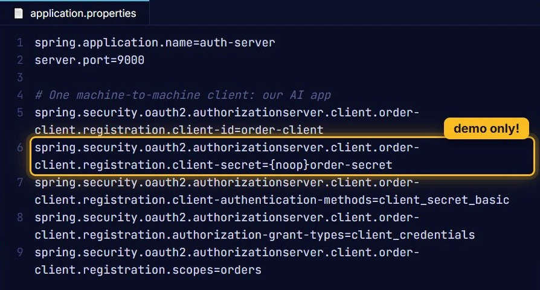

## Step 2: Lock the MCP server

I copied the order server from lab 5.2, and added two dependencies: OAuth 2 Resource Server, and MCP Server Security.

**pom.xml · added**

- **spring-boot-starter-security-oauth2-resource-server**: validate tokens
- **mcp-server-security-spring-boot**: MCP + OAuth (Spring AI community)

The whole lock is one SecurityConfig. Every request must be authenticated.

**`SecurityConfig.java`**:

```java
package dev.course.orders;

import static org.springaicommunity.mcp.security.server.config.McpServerOAuth2Configurer.mcpServerOAuth2;

import org.springframework.context.annotation.Bean;
import org.springframework.context.annotation.Configuration;
import org.springframework.security.config.annotation.web.builders.HttpSecurity;
import org.springframework.security.web.SecurityFilterChain;

@Configuration
public class SecurityConfig {

    @Bean
    SecurityFilterChain securityFilterChain(HttpSecurity http) throws Exception {
        return http
                .authorizeHttpRequests(auth -> auth.anyRequest().authenticated())
                // Every MCP request needs a valid token from our authorization server
                .with(mcpServerOAuth2(), mcp -> mcp.authorizationServer("http://localhost:9000"))
                .build();
    }
}
```

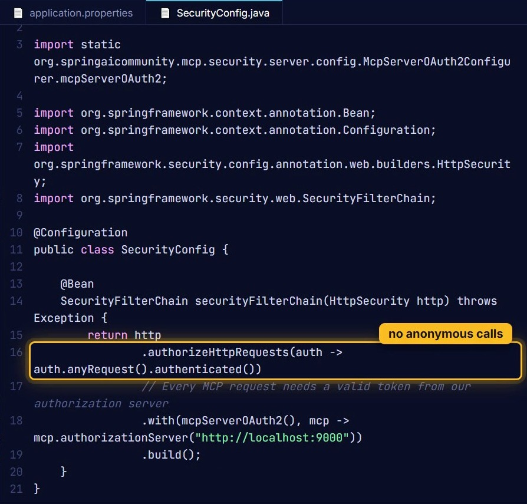

And mcpServerOAuth2, with the address of our authorization server. It validates tokens, and publishes the discovery metadata.

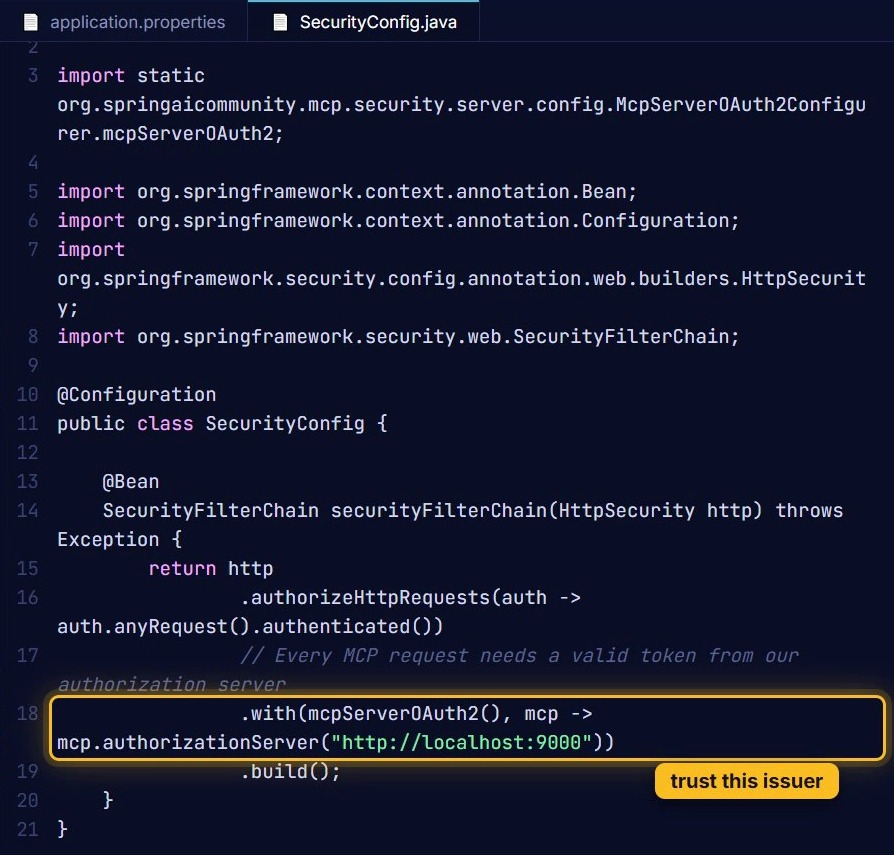

## Step 3: Test with curl

Both servers are running. First, initialize without a token.

```bash
$ curl -i localhost:8081/mcp -H "Content-Type: application/json" -H "Accept: application/json, text/event-stream" -d '{"jsonrpc":"2.0","id":0,"method":"initialize","params":{"protocolVersion":"2025-06-18","capabilities":{},"clientInfo":{"name":"curl","version":"1.0"}}}'
HTTP/1.1 401
WWW-Authenticate: Bearer resource_metadata=
  http://localhost:8081/.well-known/
  oauth-protected-resource/mcp
```

401. And the header points to the metadata. Let's follow it.

```bash
$ curl localhost:8081/.well-known/oauth-protected-resource/mcp
{"resource":"http://localhost:8081/mcp","bearer_methods_
supported":["header"],..."authorization_servers":["http:
//localhost:9000"],"resource_name":"Spring MCP Resource
Server"}
```

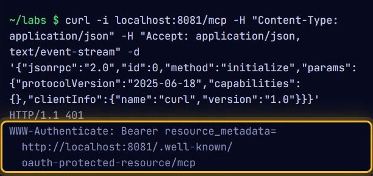

The metadata says: my tokens come from localhost 9,000. So I ask it for a token, with the client id and secret.

```bash
$ curl -u order-client:order-secret -d grant_type=client_credentials -d scope=orders localhost:9000/oauth2/token
{"access_token":"eyJraWQiOiJiN2U4YjNlOS05NzU3LTRiNjItYjA
2Ny1hOTUxODEyN2FjZGYiLCJhbGciOiJSUzI1NiJ9.eyJzdWIiOi..."
,"scope":"orders","token_type":"Bearer","expires_in":300
}
```

An access token, valid for 300 seconds. Decoded, it says who it's for, the scope, and who signed it.

**The token, decoded (real)**

- **sub**: order-client
- **scope**: [orders]
- **iss**: http://localhost:9000
- **aud**: order-client

Same initialize, now with the token in the Authorization header: 200. We're in.

```bash
$ curl -i localhost:8081/mcp -H "Authorization: Bearer $TOKEN" -H "Content-Type: application/json" -H "Accept: application/json, text/event-stream" -d '{"jsonrpc":"2.0","id":0,"method":"initialize","params":{"protocolVersion":"2025-06-18","capabilities":{},"clientInfo":{"name":"curl","version":"1.0"}}}'
HTTP/1.1 200
Mcp-Session-Id: ...

{"jsonrpc":"2.0","id":0,"result":{...}}
```

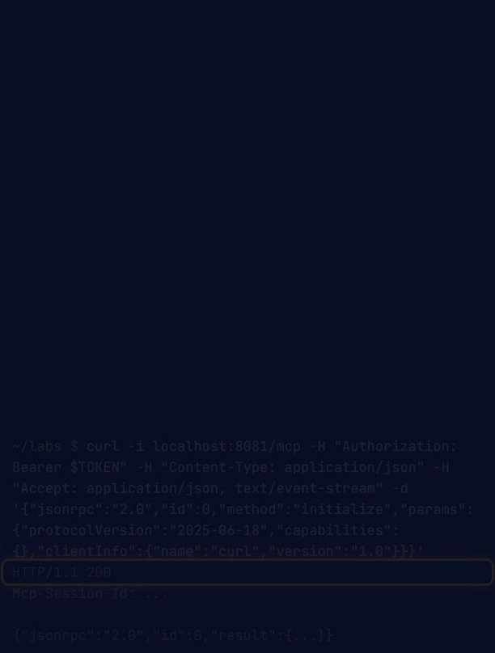

## Step 4: A client with a token

The AI app has Ollama, the MCP client, OAuth 2 Client, and MCP Client Security.

**`application.properties`** (`secure-order-client/src/main/resources/application.properties`):

```properties
spring.application.name=secure-order-client
spring.ai.ollama.chat.model=qwen2.5:3b
spring.ai.ollama.chat.temperature=0.0

# The MCP server, over Streamable HTTP
spring.ai.mcp.client.streamable-http.connections.orders.url=http://localhost:8081

# How this app gets a token: client credentials, from our authorization server
spring.security.oauth2.client.registration.order-server.provider=auth-server
spring.security.oauth2.client.registration.order-server.client-id=order-client
spring.security.oauth2.client.registration.order-server.client-secret=order-secret
spring.security.oauth2.client.registration.order-server.authorization-grant-type=client_credentials
spring.security.oauth2.client.registration.order-server.scope=orders
spring.security.oauth2.client.provider.auth-server.issuer-uri=http://localhost:9000
```

The properties have the MCP server URL, and a client registration: the same id, secret, grant type and scope we used with curl.

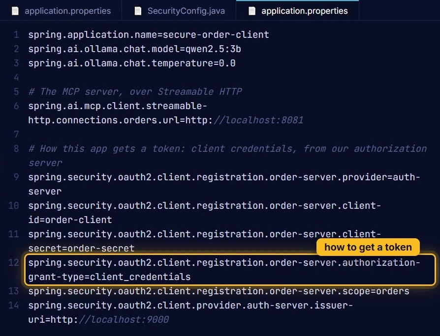

McpSecurityConfig has one important bean: a request customizer. Before every MCP request, it gets a token, from a cache when possible, and adds the Bearer header.

**`McpSecurityConfig.java`**:

```java
package dev.course.client;

import org.springaicommunity.mcp.security.client.sync.oauth2.http.client.OAuth2ClientCredentialsSyncHttpRequestCustomizer;
import org.springframework.context.annotation.Bean;
import org.springframework.context.annotation.Configuration;
import org.springframework.security.config.annotation.web.builders.HttpSecurity;
import org.springframework.security.oauth2.client.AuthorizedClientServiceOAuth2AuthorizedClientManager;
import org.springframework.security.oauth2.client.OAuth2AuthorizedClientService;
import org.springframework.security.oauth2.client.registration.ClientRegistrationRepository;
import org.springframework.security.web.SecurityFilterChain;

import io.modelcontextprotocol.client.transport.customizer.McpSyncHttpClientRequestCustomizer;

@Configuration
public class McpSecurityConfig {

    // Adds "Authorization: Bearer <token>" to every request sent to the MCP server
    @Bean
    McpSyncHttpClientRequestCustomizer oauth2Token(ClientRegistrationRepository registrations,
                                                    OAuth2AuthorizedClientService clients) {
        var manager = new AuthorizedClientServiceOAuth2AuthorizedClientManager(registrations, clients);
        return new OAuth2ClientCredentialsSyncHttpRequestCustomizer(manager, "order-server");
    }

    // This demo app's own endpoints stay open
    @Bean
    SecurityFilterChain securityFilterChain(HttpSecurity http) throws Exception {
        return http.authorizeHttpRequests(auth -> auth.anyRequest().permitAll())
                .csrf(csrf -> csrf.disable())
                .build();
    }
}
```

The second bean keeps this demo app's own endpoints open. And the controller is the one from section three: a ChatClient, with the MCP tools as default tools.

**`AssistantController.java`** (`secure-order-client/src/main/java/dev/course/client/AssistantController.java`):

```java
package dev.course.client;

import org.springframework.ai.chat.client.ChatClient;
import org.springframework.ai.tool.ToolCallbackProvider;
import org.springframework.web.bind.annotation.GetMapping;
import org.springframework.web.bind.annotation.RequestParam;
import org.springframework.web.bind.annotation.RestController;

@RestController
public class AssistantController {

    private final ChatClient chatClient;

    public AssistantController(ChatClient.Builder builder, ToolCallbackProvider mcpTools) {
        this.chatClient = builder
                .defaultSystem("You are the assistant of a tech shop. Use the tools to answer questions about orders.")
                .defaultToolCallbacks(mcpTools)
                .build();
    }

    @GetMapping("/ask")
    public String ask(@RequestParam String q) {
        return chatClient.prompt().user(q).call().content();
    }
}
```

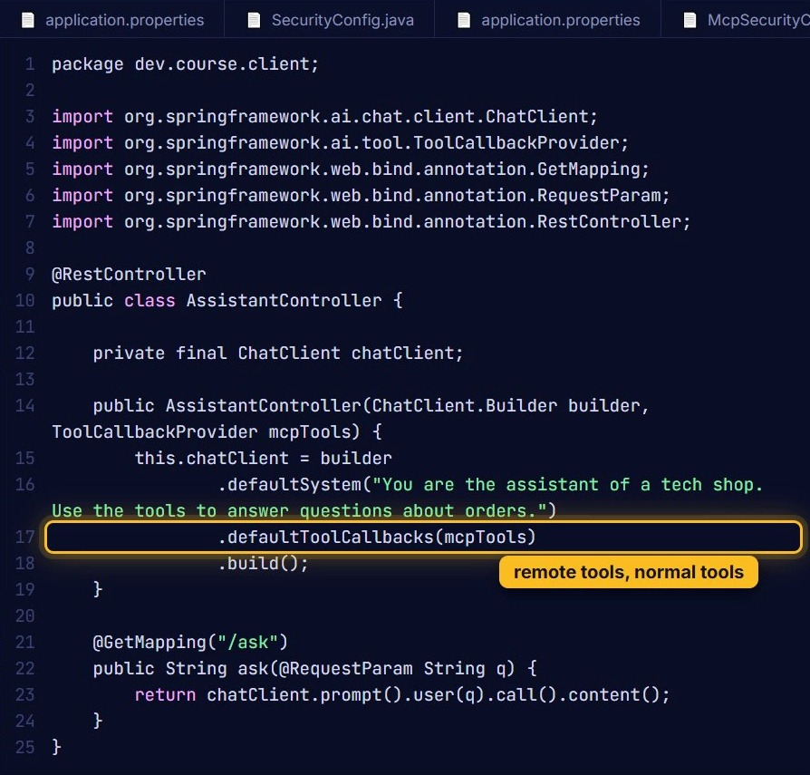

## Step 5: Ask the AI

The client starts, connects, and gets its token. Where is my order A-1001?

```bash
$ cd secure-order-client && ./mvnw spring-boot:run
...
Started SecureOrderClientApplication in 4.5 seconds
```

```bash
$ curl "localhost:8080/ask?q=Where+is+my+order+A-1001%3F"
Your order A-1001 is currently in the SHIPPED status and
is expected to be delivered on 2026-11-20.
```

Shipped, arriving November twentieth. Now: please cancel A-1001.

```bash
$ curl "localhost:8080/ask?q=Please+cancel+my+order+A-1001."
I'm sorry, but the order A-1001 is already in the
SHIPPED status and cannot be cancelled.
```

Refused: it's shipped. That's our Java rule, on the server. And cancel A-1002: done.

```bash
$ curl "localhost:8080/ask?q=Please+cancel+my+order+A-1002."
Your order A-1002 has been cancelled.
```

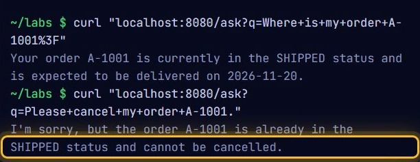

The server's log shows each tool call, coming through the secured connection.

```bash
$ # secure-order-server log
TOOL find_order(A-1001)
TOOL cancel_order(A-1001)
TOOL cancel_order(A-1002)
```

Last test: I start the client with a wrong secret. It doesn't even start. The authorization server answered: invalid client. No token, no tools.

```bash
$ java -jar target/secure-order-client-0.0.1-SNAPSHOT.jar --spring.security.oauth2.client.registration.order-server.client-secret=wrong-secret
...
APPLICATION FAILED TO START
...
Caused by: ...ClientAuthorizationException:
[invalid_token_response] ... 401 on POST request
for "http://localhost:9000/oauth2/token":
"{"error":"invalid_client"}"
```

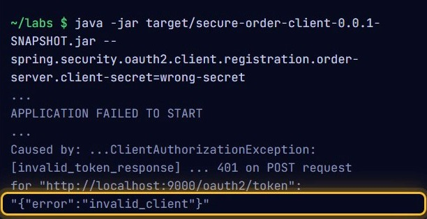

## 3 pro tips

The MCP client connects at startup. So a bad secret, or a server that's down, stops your app from starting. Decide if that's what you want.

Add scopes per tool. Give a reporting app orders read, and only the order desk orders write.

And turn on audience validation in production, so a token made for another app can't be used here.

- **Startup dependency**: Bad secret or server down = no start
- **Scopes per tool**: orders.read vs orders.write
- **Audience**: validateAudienceClaim(true)

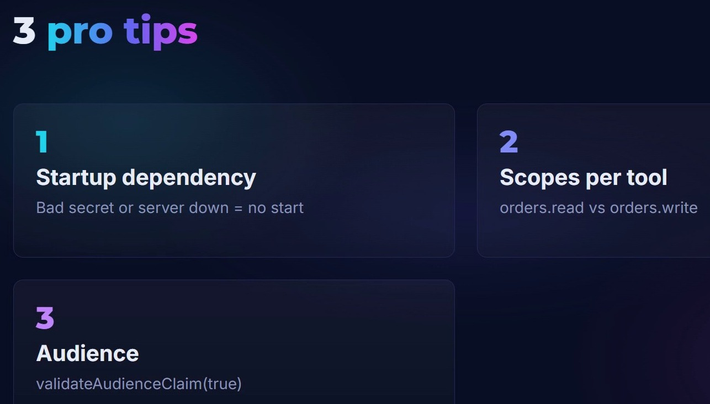

## Your challenge

Your challenge: split the scope in two, orders read and orders write. Make cancel order require orders write. Then give the client only orders read, and try to cancel.

Then build the section five challenge: an MCP server for a library catalogue.

- **Read vs write**: cancel_order needs orders.write
- **Section 5 challenge**: An MCP server for a library catalogue

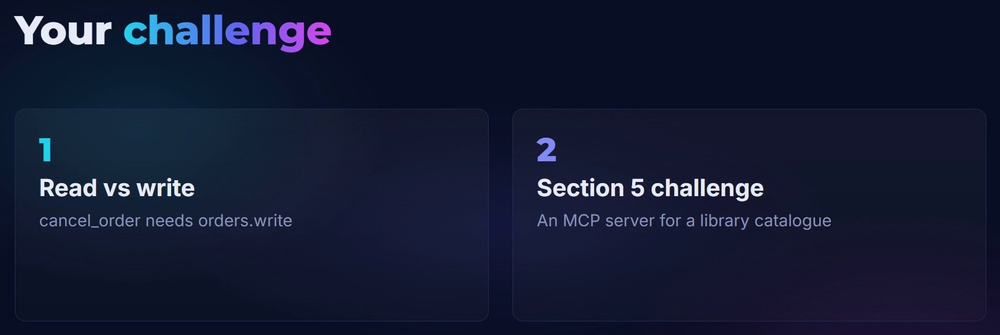

## Recap

- Authorization server **issues**, MCP server **validates**
- `mcpServerOAuth2()` locks the server; a **customizer** adds tokens
- No token, **401**; wrong secret, no start

## Get the code and the quiz

- **Code for this lab**: https://github.com/NEDBS12/youtube-tuto/tree/main/spring-ai-course/labs/secure-order-server
- **All course code, quizzes and resources**: https://github.com/NEDBS12/youtube-tuto/tree/main/spring-ai-course
- **Section 5 eval and lesson quizzes**: https://nedbs12.github.io/youtube-tuto/spring-ai-course/quiz/
- **Spring AI MCP security docs**: https://docs.spring.io/spring-ai/reference/api/mcp/mcp-security.html
- **MCP security library (Spring AI community)**: https://github.com/spring-ai-community/mcp-security
- **Spring AI reference docs**: https://docs.spring.io/spring-ai/reference/

🎥 **Watch the video tutorial:** {VIDEO_URL}

**Previous: Lesson 5.3, MCP security. Section 5 is complete: take the Section 5 eval (link above) to check your level!**

*The editor and terminal in the screenshots are a simplified recreation; the code and the outputs come from real runs of the lab.*

*I'm Zero Cost AI: I build AI tools and tutorials and share them for free. Follow me on Medium for the next lessons, and subscribe on YouTube: https://www.youtube.com/@zerocostai-f1h*
