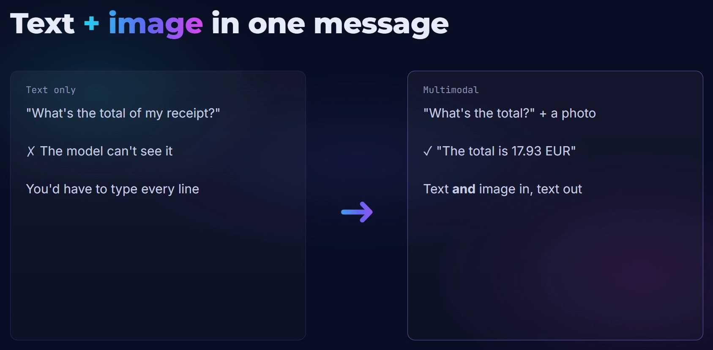
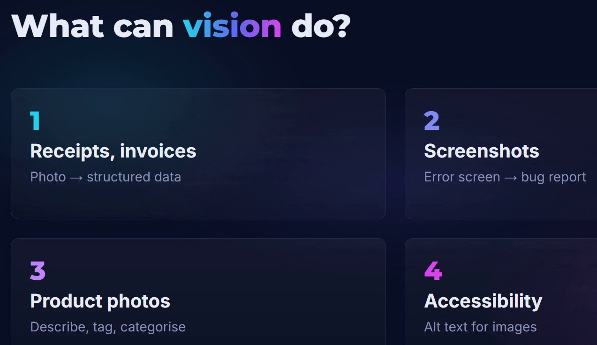
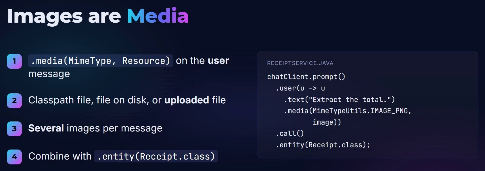
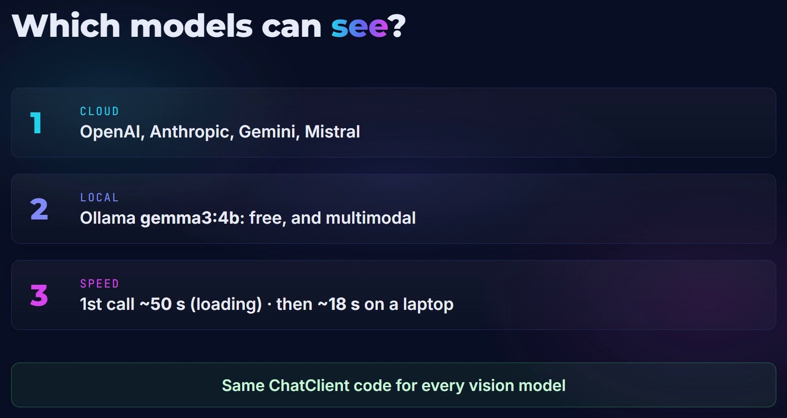
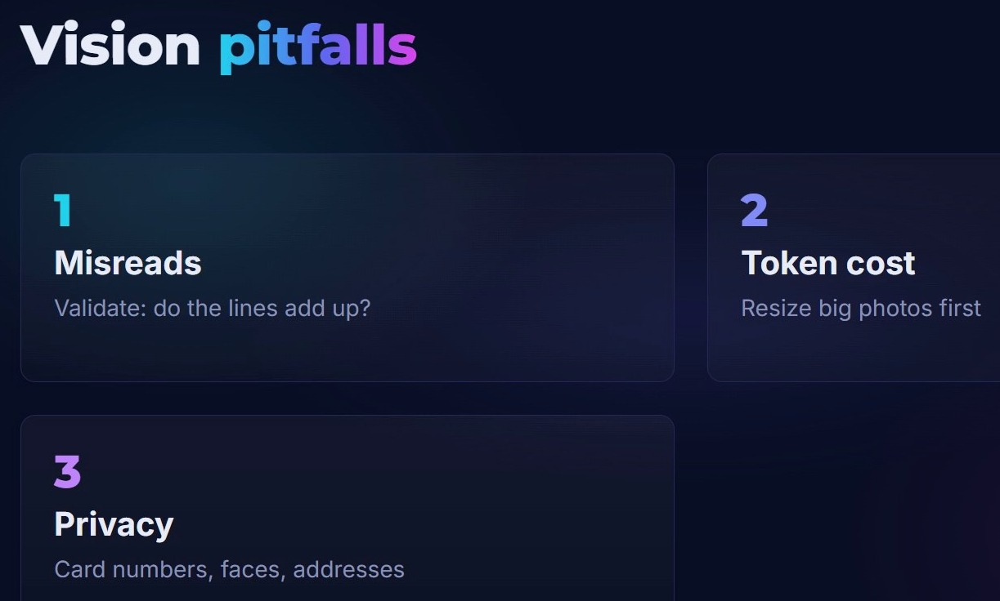

You take a photo of a shop receipt. Two seconds later, your app has the shop, the date, every line and the total, as a Java record.

Welcome to section six: multimodality. We start with vision: images as input.

It's lesson 6.1 of my free **Spring AI: Novice to Expert** course, where every lesson has a concept part and a hands-on lab, and everything runs on a free local model with Ollama.

🎥 **Prefer video?** Watch the full tutorial here:

{VIDEO}

## Text + image in one message

Until now, every prompt was text only.

A multimodal model accepts more than text. In one message, you send a question and an image, and the model answers about both.

The answer is still text. So everything you learned still works: system messages, templates, structured output.

### Text only

- "What's the total of my receipt?"
- ✗ The model can't see it
- You'd have to type every line

### Multimodal

- "What's the total?" + a photo
- ✓ "The total is 17.93 EUR"
- Text **and** image in, text out



## What can vision do?

Where is this useful? Four examples.

Receipts and invoices: turn a photo into data, for expenses.

Screenshots: a user sends an error screen, and you get a bug report.

Product photos: describe, tag and categorise a catalogue.

And accessibility: write alt text for images.

- **Receipts, invoices**: Photo → structured data
- **Screenshots**: Error screen → bug report
- **Product photos**: Describe, tag, categorise
- **Accessibility**: Alt text for images



## Images are Media

In Spring AI, an image is a Media object: a MIME type, plus the data, as a Resource or a URL.

With the ChatClient, you add it to the user message, with media.

The resource can be a classpath file, a file on disk, or an uploaded multipart file.

You can attach several images to the same message.

And it works with entity, so the answer can be a Java record.

- `.media(MimeType, Resource)` on the **user** message
- Classpath file, file on disk, or **uploaded** file
- **Several** images per message
- Combine with `.entity(Receipt.class)`

In code:

```java
chatClient.prompt()
  .user(u -> u
    .text("Extract the total.")
    .media(MimeTypeUtils.IMAGE_PNG,
           image))
  .call()
  .entity(Receipt.class);
```



## Which models can see?

Which models can see? You need a vision model. A text-only model can't read the image.

In the cloud: OpenAI, Anthropic, Gemini and Mistral all have vision models, and Spring AI supports them.

Locally, with Ollama: gemma3, the model we've used all course, is multimodal. So it's still free.

In my test, the first call took 50 seconds, because the model was loading. The next one took 18 seconds, on a laptop.

Same code for every provider. You only change the starter and the model name.

- **Cloud**: OpenAI, Anthropic, Gemini, Mistral
- **Local**: Ollama **gemma3:4b**: free, and multimodal
- **Speed**: 1st call **~50 s** (loading) · then **~18 s** on a laptop

**Same ChatClient code for every vision model**



## Vision pitfalls

Three things to watch.

Models misread. A blurry five can become a six. So validate: in the lab, we'll check that the lines add up to the total.

Images cost tokens, often more than your question. Resize big photos before you send them.

And privacy. A receipt can show a card number. Ours did. Decide what you store, and never log the images.

- **Misreads**: Validate: do the lines add up?
- **Token cost**: Resize big photos first
- **Privacy**: Card numbers, faces, addresses



## Recap

- A multimodal prompt = **text + image**, answer in text
- `.media()` on the user message; works with `.entity()`
- Use a **vision model**, then validate what it reads

## Quick quiz

Test yourself before you read the answers.

1. **Media**: How do you add an image to a prompt?
2. **Model**: Your text-only model ignores images. Why?
3. **Trust**: The model read a total of 17.98 instead of 17.93. What helps?

**Answers:**

1. `.media(mimeType, resource)` on the **user** message
2. It's not a **vision** model
3. **Validate** the data: do the lines add up?

The full five-question quiz for this lesson is free on the course quiz page: https://nedbs12.github.io/youtube-tuto/spring-ai-course/quiz/

## Get the code and the quiz

- **Lab code for this lesson**: https://github.com/NEDBS12/youtube-tuto/tree/main/spring-ai-course/labs/receipt-reader
- **All course code, quizzes and resources**: https://github.com/NEDBS12/youtube-tuto/tree/main/spring-ai-course
- **Lesson quiz and section evals**: https://nedbs12.github.io/youtube-tuto/spring-ai-course/quiz/
- **Spring AI multimodality docs**: https://docs.spring.io/spring-ai/reference/api/multimodality.html
- **Spring AI reference docs**: https://docs.spring.io/spring-ai/reference/

🎥 **Watch the video tutorial:** {VIDEO_URL}

**Previous: Lab 5.3 (Section 5 complete). Next: Lab 6.1, a receipt reader.**

*I'm Zero Cost AI: I build AI tools and tutorials and share them for free. Follow me on Medium for the next lessons, and subscribe on YouTube: https://www.youtube.com/@zerocostai-f1h*
