Today you'll build a receipt reader: send a photo, get a Java record, with every line and the total.

And because models misread, the app will check the math.

It's lab 6.1 of my free **Spring AI: Novice to Expert** course, where every lesson has a concept part and a hands-on lab, and everything runs on a free local model with Ollama.

🎥 **Prefer video?** Watch the full tutorial here:

{VIDEO}

## What we'll build

A vision model. A record for the receipt. A prompt with an image. Two endpoints. And then we run it on two receipts.

1. **A vision model**: gemma3:4b, free and local
2. **The record**: Receipt, items, tax, total
3. **Image + prompt**: media() and entity()
4. **Endpoints**: Upload, or a sample
5. **Run it**: Two receipts, and a math check

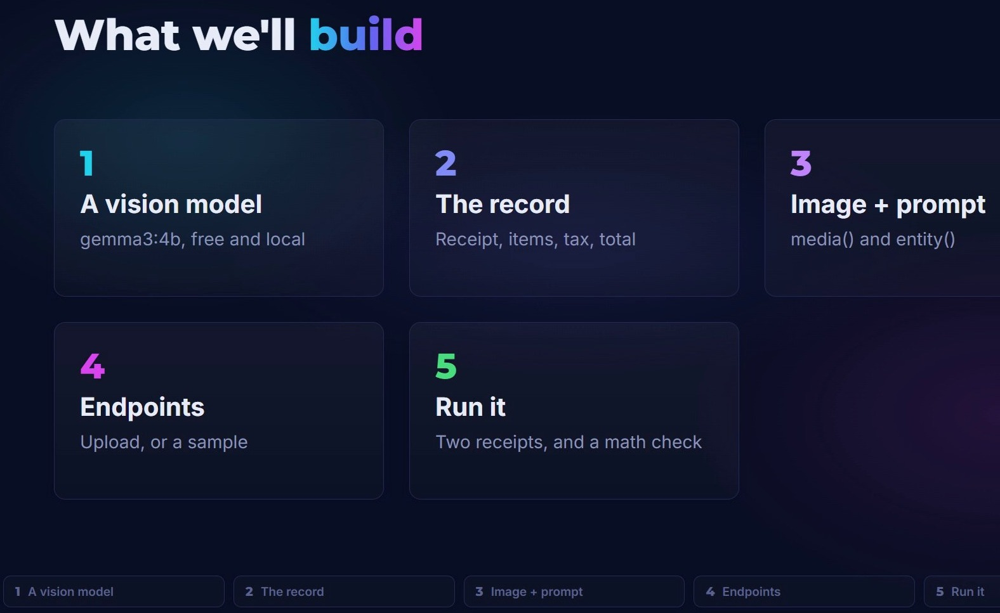

## Step 1: A vision model

Good news: gemma3, our model since lesson one, can read images. Nothing new to pull.

```bash
$ ollama show gemma3:4b
  Capabilities
    completion
    vision
```

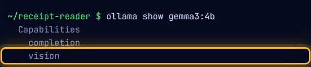

The project has only the web and Ollama starters. In the properties: the model, and temperature zero. We want to copy data, not be creative. I also raise the upload limit to ten megabytes, for phone photos.

**`application.properties`** (`src/main/resources/application.properties`):

```properties
spring.application.name=receipt-reader
spring.ai.ollama.chat.model=gemma3:4b
spring.ai.ollama.chat.options.temperature=0.0
spring.servlet.multipart.max-file-size=10MB
spring.servlet.multipart.max-request-size=10MB
```

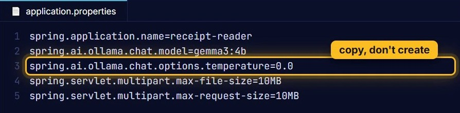

Two sample receipts are in the resources folder. Here's the first one: a café, three lines, tax, and a total.

**receipts/cafe.png**

- **CAFE LUMIERE**: 2026-11-14
- **2 x Cappuccino**: 7.60
- **2 x Croissant**: 4.20
- **1 x Orange juice**: 4.50
- **TAX 10%**: 1.63
- **TOTAL EUR**: 17.93

## Step 2: The record

A receipt has a shop, a date, a list of items, the tax, the total and the currency. Each item has a name, a quantity and a line total.

**`Receipt.java`**:

```java
package dev.course.receipt;

import java.util.List;

public record Receipt(String shop, String date, List<Item> items, double tax, double total, String currency) {

    public record Item(String name, int quantity, double lineTotal) {
    }

    /** A vision model can misread a digit: check that the lines plus tax add up to the total. */
    public boolean addsUp() {
        double sum = items.stream().mapToDouble(Item::lineTotal).sum() + tax;
        return Math.abs(sum - total) < 0.01;
    }

}
```

And one method: adds up. The lines plus the tax must equal the total, to the cent. If the model misreads a digit, this catches it.

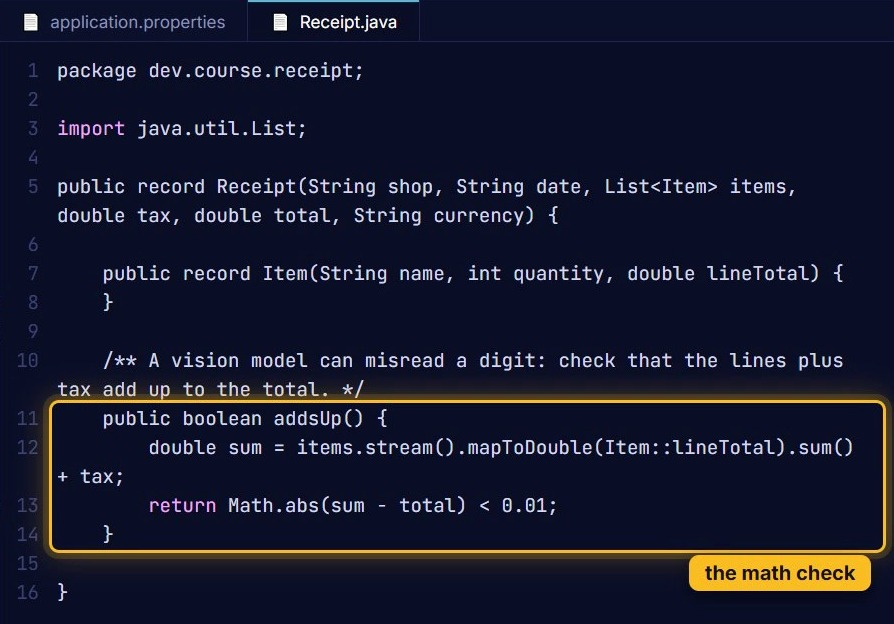

## Step 3: Image + prompt

A system message sets the rules: copy exactly what's printed, and never guess a value you can't read.

**`ReceiptService.java`**:

```java
package dev.course.receipt;

import org.springframework.ai.chat.client.ChatClient;
import org.springframework.core.io.Resource;
import org.springframework.stereotype.Service;
import org.springframework.util.MimeType;

@Service
public class ReceiptService {

    private final ChatClient chatClient;

    public ReceiptService(ChatClient.Builder builder) {
        this.chatClient = builder
            .defaultSystem("""
                    You read photos of shop receipts and extract the data exactly as printed.
                    Copy names and numbers from the image. Never guess a value you can't read.""")
            .build();
    }
```

Then the read method. The user message has a text, and the image, with media: its MIME type and the resource. And entity turns the answer into our record.

**`ReceiptService.java`** (continued):

```java
    public Receipt read(Resource image, MimeType type) {
        return chatClient.prompt()
            .user(u -> u.text("Extract the shop name, the date, every item line, the tax and the final total.")
                .media(type, image))
            .call()
            .entity(Receipt.class);
    }
```

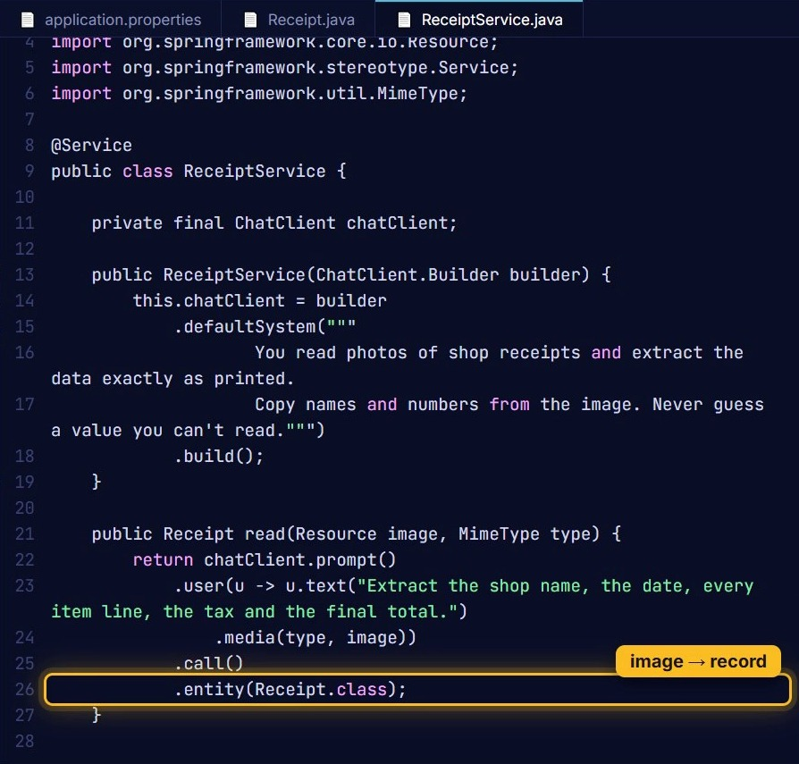

And a describe method, with content instead of entity, to see what the model sees.

**`ReceiptService.java`** (continued):

```java
    public String describe(Resource image, MimeType type) {
        return chatClient.prompt()
            .user(u -> u.text("Describe this image in two sentences.").media(type, image))
            .call()
            .content();
    }

}
```

## Step 4: Endpoints

A POST endpoint takes an uploaded photo. A multipart file gives us both the resource and its content type.

**`ReceiptController.java`** (`src/main/java/dev/course/receipt/ReceiptController.java`):

```java
package dev.course.receipt;

import java.util.Map;

import org.springframework.core.io.ClassPathResource;
import org.springframework.util.MimeType;
import org.springframework.util.MimeTypeUtils;
import org.springframework.web.bind.annotation.GetMapping;
import org.springframework.web.bind.annotation.PathVariable;
import org.springframework.web.bind.annotation.PostMapping;
import org.springframework.web.bind.annotation.RequestParam;
import org.springframework.web.bind.annotation.RestController;
import org.springframework.web.multipart.MultipartFile;

@RestController
public class ReceiptController {

    private final ReceiptService service;

    public ReceiptController(ReceiptService service) {
        this.service = service;
    }

    // upload your own photo: curl -F "file=@my-receipt.jpg" localhost:8080/receipts
    @PostMapping("/receipts")
    public Map<String, Object> upload(@RequestParam MultipartFile file) {
        return check(service.read(file.getResource(), MimeType.valueOf(file.getContentType())));
    }

    // the two samples in src/main/resources/receipts: cafe, hardware
    @GetMapping("/receipts/sample/{name}")
    public Map<String, Object> sample(@PathVariable String name) {
        return check(service.read(new ClassPathResource("receipts/" + name + ".png"), MimeTypeUtils.IMAGE_PNG));
    }

    @GetMapping("/describe/{name}")
    public String describe(@PathVariable String name) {
        return service.describe(new ClassPathResource("receipts/" + name + ".png"), MimeTypeUtils.IMAGE_PNG);
    }

    private Map<String, Object> check(Receipt r) {
        return Map.of("receipt", r, "addsUp", r.addsUp());
    }

}
```

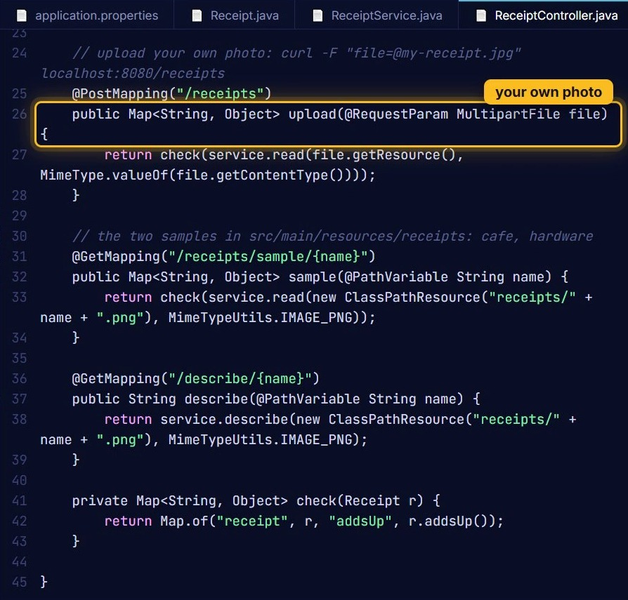

A GET endpoint reads one of the two samples, and one more describes it. Every result goes out with the adds up check.

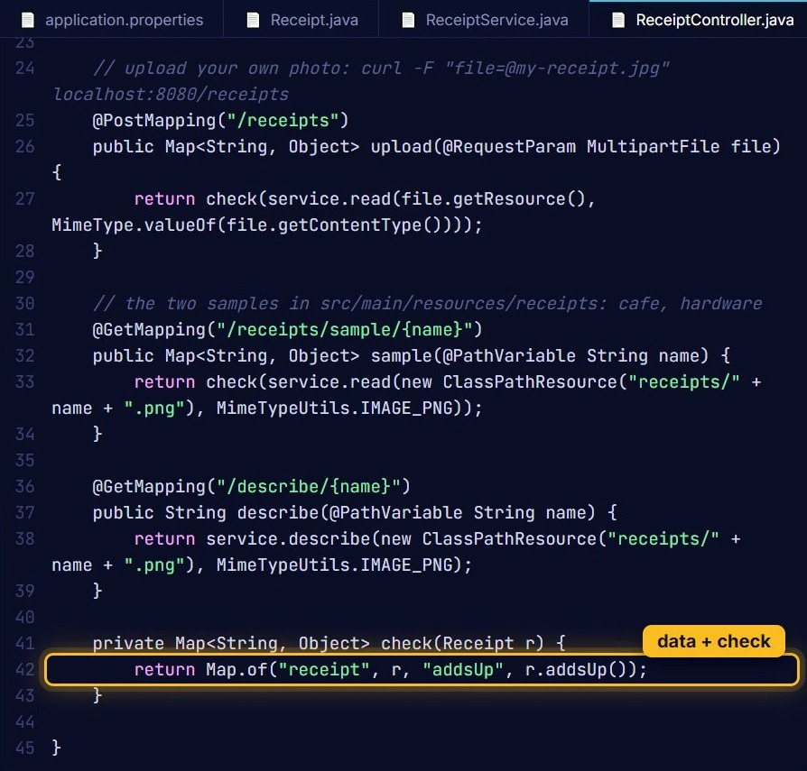

## Step 5: Run it

First, the café receipt.

```bash
$ ./mvnw spring-boot:run
...
Started ReceiptReaderApplication in 3.9 seconds
```

```bash
$ curl localhost:8080/receipts/sample/cafe
{"receipt":{"shop":"CAFE LUMIERE",
 "date":"2026-11-14",
 "items":[
  {"name":"Cappuccino",
   "quantity":2,"lineTotal":7.6},
  {"name":"Croissant",
   "quantity":2,"lineTotal":4.2},
  {"name":"Orange juice",
   "quantity":1,"lineTotal":4.5}],
 "tax":1.63,"total":17.93,"currency":"EUR"},
 "addsUp":true}
```

Every line is right: two cappuccinos, 7.60, and the total, 17.93. And adds up is true. The first call took 50 seconds, because the model was loading.

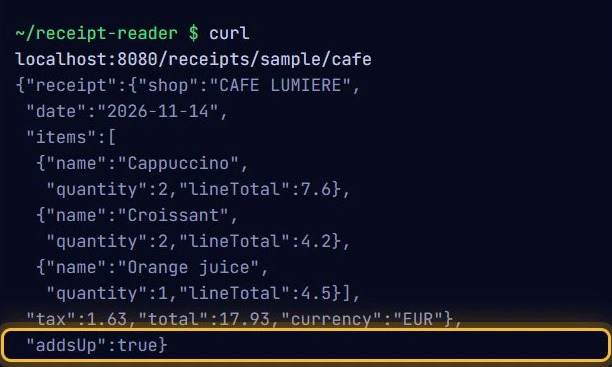

Now the hardware store. Four lines, quantities, a 20% tax. 18 seconds this time, and again, it adds up.

```bash
$ curl localhost:8080/receipts/sample/hardware
{"addsUp":true,"receipt":{"shop":"Brico CENTER",
 "date":"2026-11-16",
 "items":[
  {"name":"Drill bits set",
   "quantity":1,"lineTotal":24.9},
  {"name":"Wood screws 4x40",
   "quantity":3,"lineTotal":19.35},
  {"name":"Masking tape",
   "quantity":2,"lineTotal":6.4},
  {"name":"LED bulb E27",
   "quantity":4,"lineTotal":23.96}],
 "tax":14.92,"total":89.53,"currency":"EUR"}}
```

But look at the shop name. The receipt says BRICO in capitals. The model wrote Brico. Small, but real. That's why you validate, and why you show the data to the user before you save it.

Now describe. It even read the last digits of the card. Remember the privacy warning from the lesson.

```bash
$ curl localhost:8080/describe/cafe
This is a shop receipt from Cafe Lumiere located at
12 rue des Lilas, Lyon. The receipt details a purchase
of cappuccino, croissants, and orange juice, with a
total amount of 17.93 EUR paid by card with the
transaction ID *4821*.
```

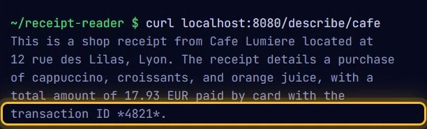

And finally, an upload, like a real phone photo. Same result.

```bash
$ curl -F "file=@cafe.png;type=image/png" localhost:8080/receipts
{"receipt":{"shop":"CAFE LUMIERE",
 "date":"2026-11-14",
  ...
 "tax":1.63,"total":17.93,"currency":"EUR"},
 "addsUp":true}
```

## 3 pro tips

Temperature zero for extraction. You want the same answer every time.

Validate everything you can compute. Sums, dates, VAT rates. And when the check fails, ask the user to confirm.

And resize photos. A phone photo is several megabytes. 1,000 pixels wide is enough to read a receipt, and it's faster.

- **Temperature 0**: Extraction, not creativity
- **Validate**: Sums, dates, rates; then confirm
- **Resize photos**: ~1000 px wide is enough

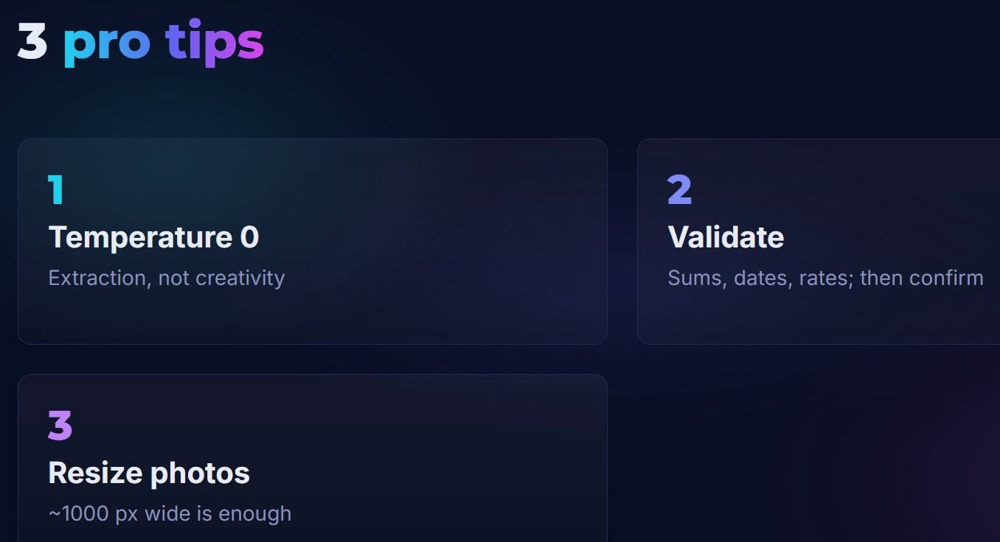

## Your challenge

Your challenge: take a photo of a real receipt with your phone, and upload it. Does it add up?

Then add a category to each item, like food or hardware, and an endpoint that returns the total per category.

- **A real photo**: Upload yours: does it add up?
- **Categories**: Total per category, from the record

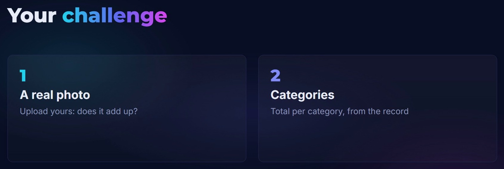

## Recap

- `.media(type, image)` sends the image **with** the prompt
- `.entity(Receipt.class)` turns it into a **record**
- Models misread: check the math

## Get the code and the quiz

- **Code for this lab**: https://github.com/NEDBS12/youtube-tuto/tree/main/spring-ai-course/labs/receipt-reader
- **All course code, quizzes and resources**: https://github.com/NEDBS12/youtube-tuto/tree/main/spring-ai-course
- **Lesson quiz and section evals**: https://nedbs12.github.io/youtube-tuto/spring-ai-course/quiz/
- **Ollama**: https://ollama.com
- **Spring AI multimodality docs**: https://docs.spring.io/spring-ai/reference/api/multimodality.html
- **Spring AI reference docs**: https://docs.spring.io/spring-ai/reference/

🎥 **Watch the video tutorial:** {VIDEO_URL}

**Previous: Lesson 6.1, vision. Next: Lesson 6.2, image generation and audio.**

*The editor and terminal in the screenshots are a simplified recreation; the code and the outputs come from real runs of the lab.*

*I'm Zero Cost AI: I build AI tools and tutorials and share them for free. Follow me on Medium for the next lessons, and subscribe on YouTube: https://www.youtube.com/@zerocostai-f1h*
