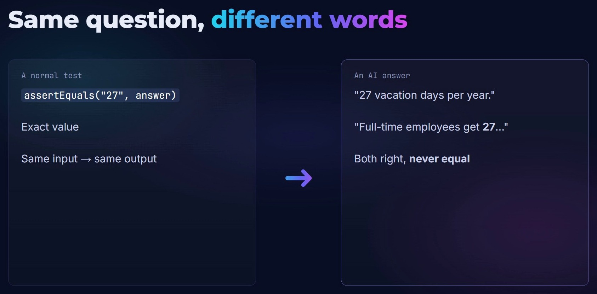
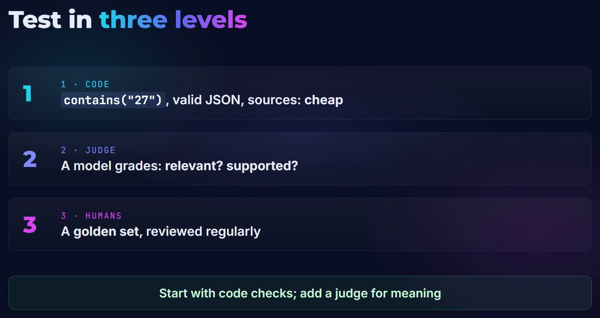
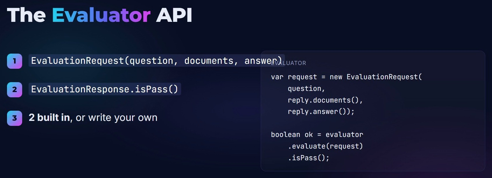
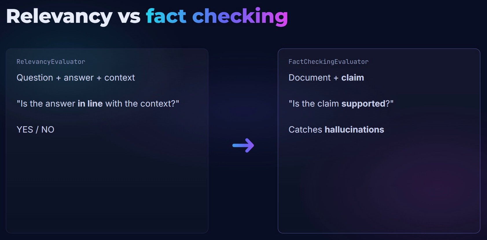
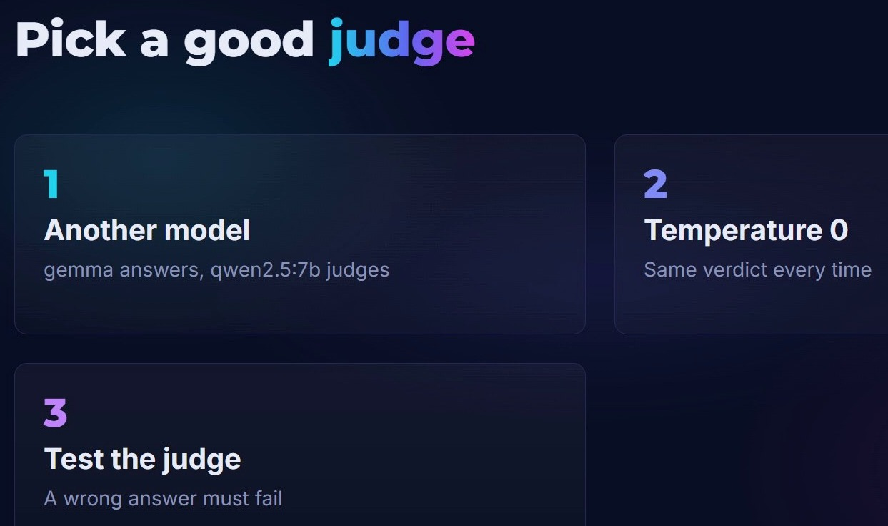
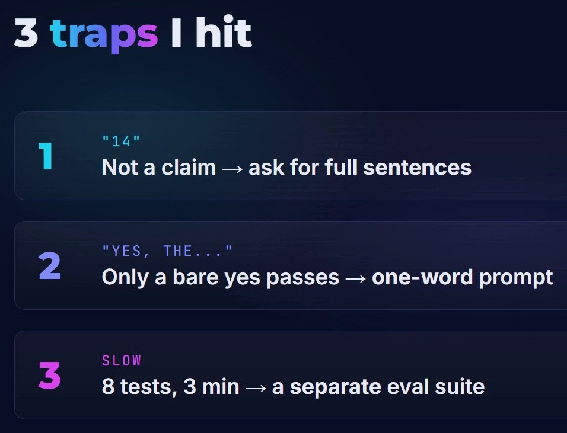

You change one line in your prompt. Is your RAG app better now, or worse? Without tests, you're guessing.

Welcome to section seven: production-ready AI. We start with the hardest question: how do you test an AI?

It's lesson 7.1 of my free **Spring AI: Novice to Expert** course, where every lesson has a concept part and a hands-on lab, and everything runs on a free local model with Ollama.

🎥 **Prefer video?** Watch the full tutorial here:

{VIDEO}

## Same question, different words

A normal unit test compares with an exact value.

With a model, the same question gives different words each time. 27 vacation days, or: full-time employees get 27 days per year. Both are right.

So assert equals breaks. We need tests that check the meaning, not the exact words.

### A normal test

- `assertEquals("27", answer)`
- Exact value
- Same input → same output

### An AI answer

- "27 vacation days per year."
- "Full-time employees get **27**..."
- Both right, **never equal**



## Test in three levels

So you test in three levels.

Level one: plain assertions. Does the answer contain 27? Is the JSON valid? Are there sources? Cheap, fast, and deterministic. Always start here.

Level two: a model grades the answer. That's called LLM as a judge. It checks what code can't: is the answer relevant? Is it supported by the documents?

Level three: people. A golden set of questions with expected answers, reviewed by a human from time to time.

Each level catches what the one before misses.

- **1 · Code**: `contains("27")`, valid JSON, sources: **cheap**
- **2 · Judge**: A model grades: **relevant? supported?**
- **3 · Humans**: A **golden set**, reviewed regularly

**Start with code checks; add a judge for meaning**



## The Evaluator API

Spring AI gives you an Evaluator interface. One method: evaluate.

The request has three parts: the question, the documents you retrieved, and the answer.

The response tells you: pass, or fail.

Two evaluators are built in. And you can write your own with the same interface.

- `EvaluationRequest(question, documents, answer)`
- `EvaluationResponse.isPass()`
- **2 built in**, or write your own

In code:

```java
var request = new EvaluationRequest(
    question,
    reply.documents(),
    reply.answer());

boolean ok = evaluator
    .evaluate(request)
    .isPass();
```



## Relevancy vs fact checking

The two built-in evaluators.

The RelevancyEvaluator asks the judge: is this answer, for this question, in line with the context? It replies yes or no.

The FactCheckingEvaluator checks one claim against the documents. Is the answer supported, or did the model make it up? That's your hallucination detector.

### RelevancyEvaluator

- Question + answer + context
- "Is the answer **in line** with the context?"
- YES / NO

### FactCheckingEvaluator

- Document + **claim**
- "Is the claim **supported**?"
- Catches **hallucinations**



## Pick a good judge

Who's the judge? Three rules.

Use a different model than the one that answers, ideally a bigger one. A model is bad at catching its own mistakes. In the lab, gemma answers and `qwen2.5:7b`, judges.

Temperature zero. You want the same verdict every time.

And test your judge! Give it a wrong answer on purpose. If it says yes, your tests are worthless.

- **Another model**: gemma answers, qwen2.5:7b judges
- **Temperature 0**: Same verdict every time
- **Test the judge**: A wrong answer must fail



## 3 traps I hit

Three traps I hit while building the lab.

One: the answer was just: 14. That's not a claim, so fact checking failed. The fix was to ask the app for full sentences.

Two: the judge said: Yes, the document states, and so on. The evaluator only passes on a plain yes. So the test failed, although the judge agreed! The fix: a prompt that asks for one word.

Three: judges are slow and not perfectly stable. Eight tests took three minutes. Run them in a separate suite, not on every build.

- **"14"**: Not a claim → ask for **full sentences**
- **"Yes, the..."**: Only a bare yes passes → **one-word** prompt
- **Slow**: 8 tests, 3 min → a **separate** eval suite



## Recap

- **Code checks** first, then an LLM judge for meaning
- `RelevancyEvaluator` and `FactCheckingEvaluator`
- Another model as judge, temperature 0, and **test the judge**

## Quick quiz

Test yourself before you read the answers.

1. **Why**: Why does assertEquals fail for AI answers?
2. **Hallucination**: Which evaluator checks if the answer is supported by the documents?
3. **Judge**: How do you know your judge works?

**Answers:**

1. Same meaning, **different words** every time
2. **FactCheckingEvaluator**
3. Give it a **wrong** answer: it must fail

The full five-question quiz for this lesson is free on the course quiz page: https://nedbs12.github.io/youtube-tuto/spring-ai-course/quiz/

## Get the code and the quiz

- **Lab code for this lesson**: https://github.com/NEDBS12/youtube-tuto/tree/main/spring-ai-course/labs/rag-evals
- **All course code, quizzes and resources**: https://github.com/NEDBS12/youtube-tuto/tree/main/spring-ai-course
- **Lesson quiz and section evals**: https://nedbs12.github.io/youtube-tuto/spring-ai-course/quiz/
- **Spring AI evaluation testing docs**: https://docs.spring.io/spring-ai/reference/api/testing.html
- **Spring AI reference docs**: https://docs.spring.io/spring-ai/reference/

🎥 **Watch the video tutorial:** {VIDEO_URL}

**Previous: Lab 6.1. Next: Lab 7.1, JUnit tests that grade the RAG app.**

*I'm Zero Cost AI: I build AI tools and tutorials and share them for free. Follow me on Medium for the next lessons, and subscribe on YouTube: https://www.youtube.com/@zerocostai-f1h*
