Today we write JUnit tests that grade our chat-with-your-docs app, using a second model as the judge.

And you'll see the tests fail for surprising reasons, and how I fixed them.

It's lab 7.1 of my free **Spring AI: Novice to Expert** course, where every lesson has a concept part and a hands-on lab, and everything runs on a free local model with Ollama.

🎥 **Prefer video?** Watch the full tutorial here:

{VIDEO}

## What we'll build

The app under test. Two judges. A golden set of questions. Two edge cases. And then we run, and fix.

1. **The app under test**: The RAG app from lab 4.4
2. **The judges**: qwen2.5:7b grades gemma3:4b
3. **The golden set**: 6 questions, expected facts
4. **Edge cases**: Out of scope, a hallucination
5. **Run and fix**: Red, then green

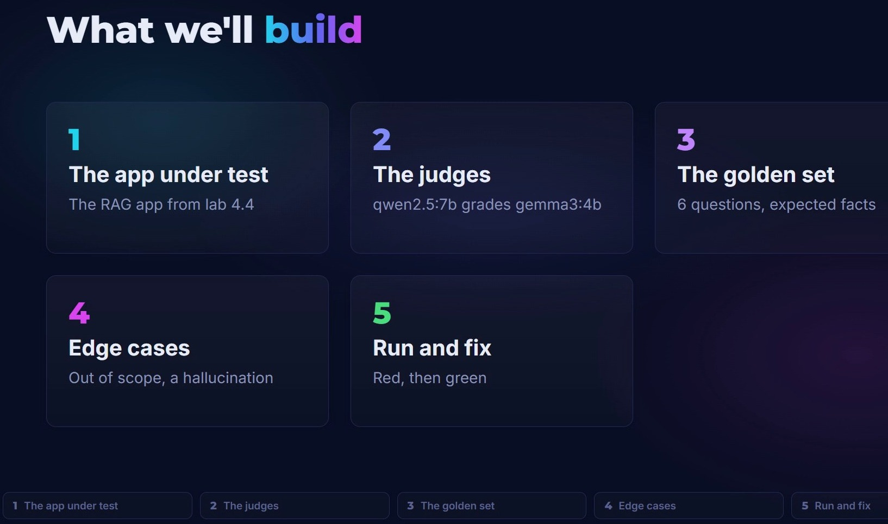

## Step 1: The app under test

It's the RAG app from lab 4.4, with the handbook PDF and the IT guide in PGVector.

**`DocsAssistant.java`** (`src/main/java/dev/course/docs/DocsAssistant.java`):

```java
package dev.course.docs;

import java.util.List;

import org.springframework.ai.chat.client.ChatClient;
import org.springframework.ai.chat.client.ChatClientResponse;
import org.springframework.ai.document.Document;
import org.springframework.ai.rag.advisor.RetrievalAugmentationAdvisor;
import org.springframework.ai.rag.generation.augmentation.ContextualQueryAugmenter;
import org.springframework.ai.rag.retrieval.search.VectorStoreDocumentRetriever;
import org.springframework.ai.vectorstore.VectorStore;
import org.springframework.stereotype.Service;

/** The RAG app from lab 4.4, as a service we can test. */
@Service
public class DocsAssistant {

    private final ChatClient chatClient;

    public DocsAssistant(ChatClient.Builder builder, VectorStore vectorStore) {
        this.chatClient = builder
                .defaultSystem("Answer in one complete sentence that repeats the subject of the question.")
                .defaultAdvisors(RetrievalAugmentationAdvisor.builder()
                        .documentRetriever(VectorStoreDocumentRetriever.builder()
                                .vectorStore(vectorStore)
                                .topK(5)
                                .similarityThreshold(0.5)
                                .build())
                        .queryAugmenter(ContextualQueryAugmenter.builder().allowEmptyContext(false).build())
                        .build())
                .build();
    }

    @SuppressWarnings("unchecked")
    public Reply ask(String question) {
        ChatClientResponse response = chatClient.prompt().user(question).call().chatClientResponse();
        List<Document> documents = (List<Document>) response.context()
                .getOrDefault(RetrievalAugmentationAdvisor.DOCUMENT_CONTEXT, List.of());
        return new Reply(response.chatResponse().getResult().getOutput().getText(), documents);
    }
}
```

I moved the RAG logic into a DocsAssistant service, so a test can call it. Ask returns a Reply: the answer, and the documents that were retrieved. The judges need both.

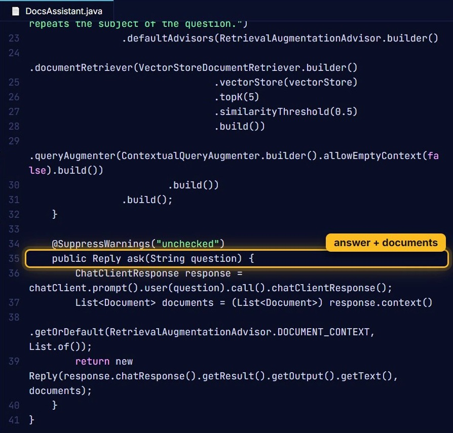

And one new line: answer in one complete sentence. You'll see why in a minute.

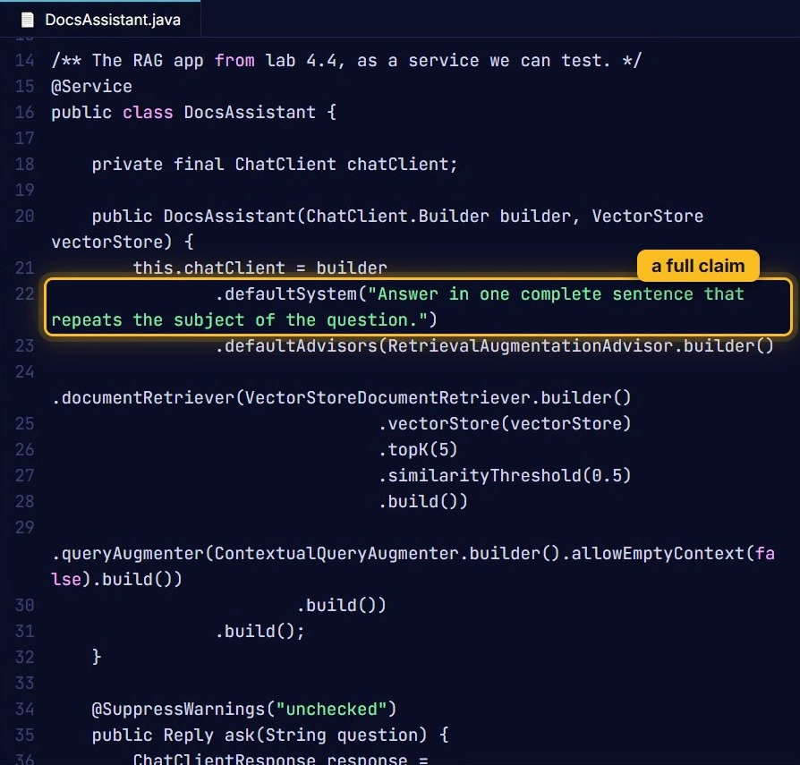

## Step 2: The judges

A Spring Boot test that starts the whole app, with PGVector from Docker Compose. Compose is skipped in tests by default, so I turn it on.

**`DocsAssistantEvaluationTest.java`**:

```java
package dev.course.docs;

import static org.assertj.core.api.Assertions.assertThat;

import org.junit.jupiter.api.BeforeEach;
import org.junit.jupiter.api.Test;
import org.junit.jupiter.params.ParameterizedTest;
import org.junit.jupiter.params.provider.CsvSource;
import org.slf4j.Logger;
import org.slf4j.LoggerFactory;
import org.springframework.ai.chat.client.ChatClient;
import org.springframework.ai.chat.evaluation.FactCheckingEvaluator;
import org.springframework.ai.chat.evaluation.RelevancyEvaluator;
import org.springframework.ai.chat.model.ChatModel;
import org.springframework.ai.chat.prompt.ChatOptions;
import org.springframework.ai.evaluation.EvaluationRequest;
import org.springframework.beans.factory.annotation.Autowired;
import org.springframework.boot.test.context.SpringBootTest;

// Starts the real app: PGVector (Docker Compose), the ingestion and Ollama
@SpringBootTest(properties = "spring.docker.compose.skip.in-tests=false")
class DocsAssistantEvaluationTest {

    private static final Logger log = LoggerFactory.getLogger(DocsAssistantEvaluationTest.class);

    // The judge is a different, bigger model than the one that answers (gemma3:4b)
    private static final String JUDGE_MODEL = "qwen2.5:7b";

    @Autowired
    DocsAssistant assistant;

    @Autowired
    ChatModel chatModel;

    RelevancyEvaluator relevancy;
    FactCheckingEvaluator factChecking;

    @BeforeEach
    void createJudges() {
        ChatClient.Builder judge = ChatClient.builder(chatModel)
                .defaultOptions(ChatOptions.builder().model(JUDGE_MODEL).temperature(0.0));
        relevancy = RelevancyEvaluator.builder().chatClientBuilder(judge).build();
        factChecking = FactCheckingEvaluator.builder(judge).build();
    }
```

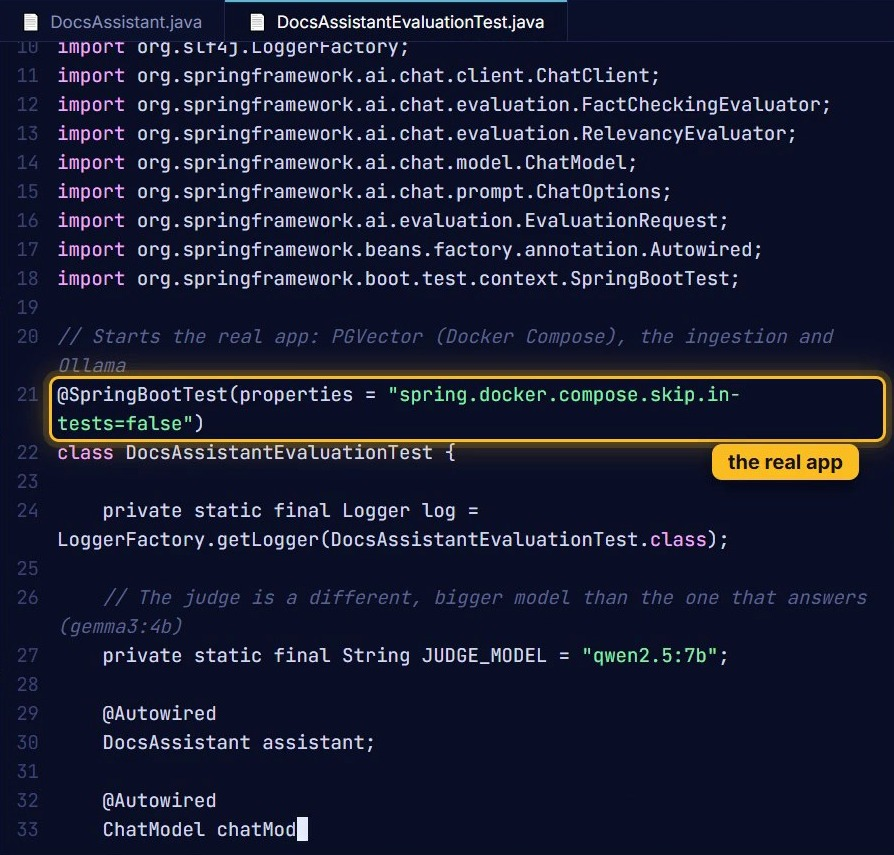

The judge is another model: `qwen2.5:7b`. Bigger than gemma, and at temperature zero. One ChatClient builder, two evaluators: relevancy, and fact checking.

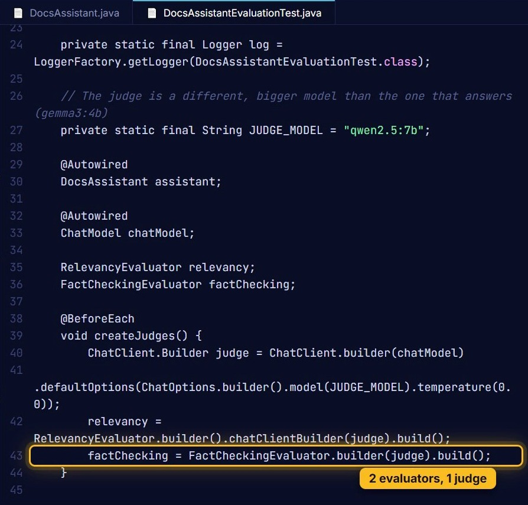

## Step 3: The golden set

Six questions, each with a fact the answer must contain. A parameterized test runs them all.

**`DocsAssistantEvaluationTest.java`** (continued):

```java
    @ParameterizedTest
    @CsvSource(delimiter = '|', value = {
            "How many vacation days do full-time employees get? | 27",
            "How much is the home office budget?                | 500",
            "Which day must everyone come to the office?        | Tuesday",
            "How many characters does a new password need?      | 14",
            "I lost my laptop. Which extension do I call?       | 4400",
            "How much is a meal covered on a business trip?     | 25"
    })
    void answersFromTheDocuments(String question, String expected) {
        Reply reply = assistant.ask(question);
        log.info("Q: {} | A: {} | sources: {}", question, reply.answer(), reply.sources());

        // 1. A plain assertion: cheap, and deterministic
        assertThat(reply.answer()).contains(expected);

        // 2. LLM as a judge: is the answer relevant, and supported by the documents?
        EvaluationRequest request = new EvaluationRequest(question, reply.documents(), reply.answer());
        assertThat(relevancy.evaluate(request).isPass()).as("relevancy").isTrue();
        assertThat(factChecking.evaluate(request).isPass()).as("fact checking").isTrue();
    }
```

First a plain assertion: the answer contains 27. Cheap and deterministic. Then the judges: one request with the question, the documents and the answer. Is it relevant? Is it supported?

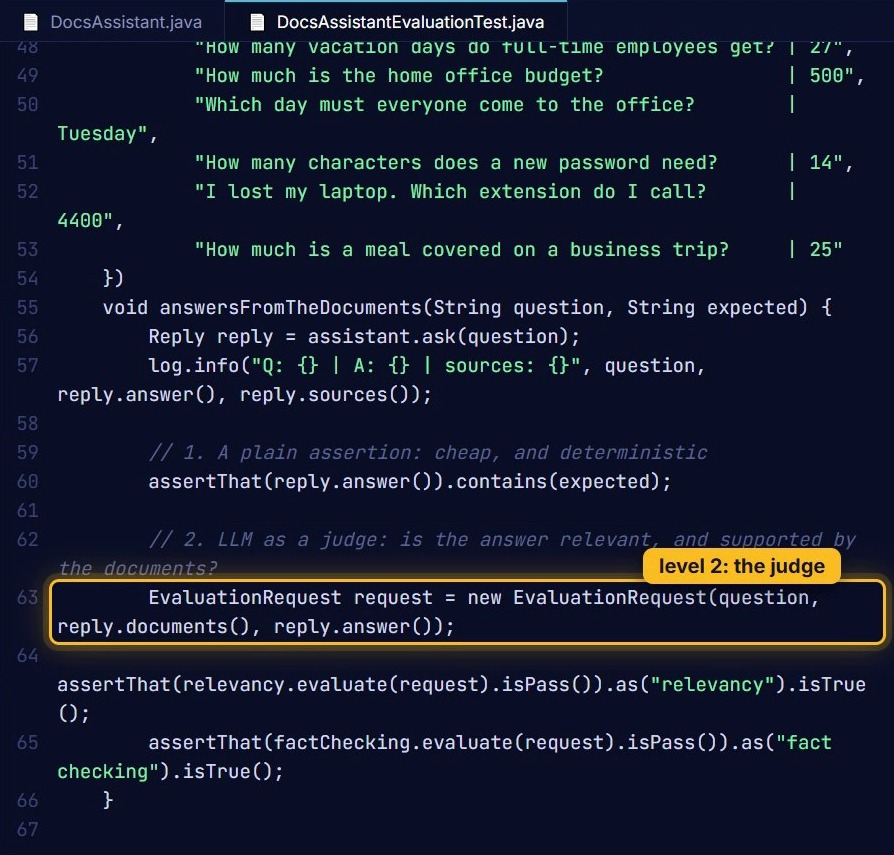

## Step 4: Edge cases

A question outside the documents: the capital of Australia. No documents should come back, and the answer must not say Canberra.

**`DocsAssistantEvaluationTest.java`** (continued):

```java
    @Test
    void declinesQuestionsOutsideTheDocuments() {
        Reply reply = assistant.ask("What is the capital of Australia?");
        log.info("Out of scope | A: {}", reply.answer());

        assertThat(reply.documents()).isEmpty();
        assertThat(reply.answer()).doesNotContain("Canberra");
    }

    @Test
    void judgeCatchesAHallucination() {
        String question = "How many vacation days do full-time employees get?";
        Reply reply = assistant.ask(question);

        // Same documents, but a made-up answer: the judge must say no
        EvaluationRequest wrong = new EvaluationRequest(question, reply.documents(),
                "Full-time employees get 35 vacation days per year.");
        assertThat(factChecking.evaluate(wrong).isPass()).isFalse();
    }
}
```

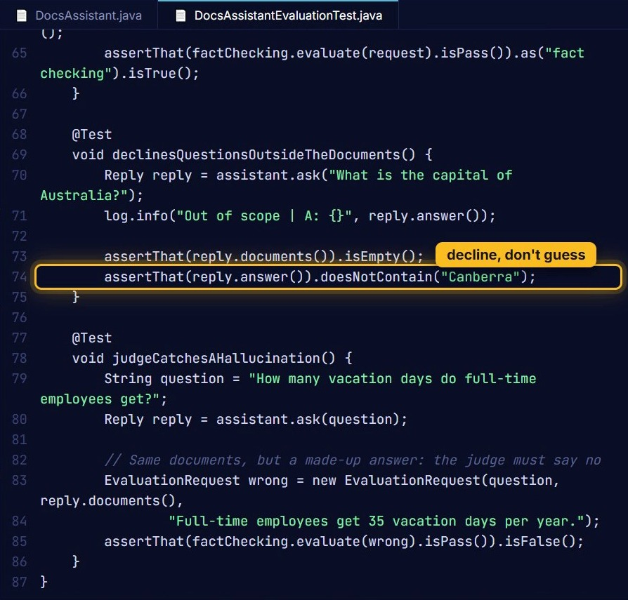

And we test the judge itself. Same documents, but a made-up answer: 35 vacation days. Fact checking must fail. If it passes, the judge is useless.

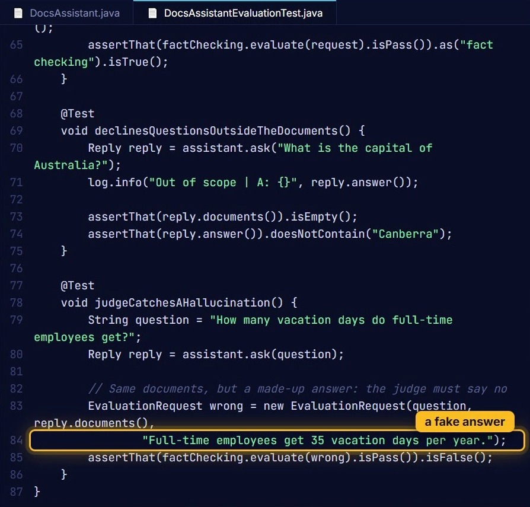

## Step 5: Run and fix

Remember the full-sentence line? On my very first run, without it, four tests failed. The answers were just: 14, or, 500 euros. That's not a claim, so fact checking can't check it.

```bash
$ ./mvnw test
...
Q: How many characters does a new password
   need? | A: 14
...
[ERROR] Tests run: 8, Failures: 4
```

With full sentences, it got better. But two tests still failed, and the answers were right! So I printed what the judge really said.

```bash
$ ./mvnw test
...
Q: Which day must everyone come to the office?
   | A: Everyone must come to the office on Tuesdays.
...
[ERROR] Tests run: 8, Failures: 2
[fact checking]
Expecting value to be true but was false
```

Here it is. The judge said: Yes. Then it explained why. But the evaluator only passes on a plain yes. The judge agreed, and the test still failed!

**What the judge really said**

> Yes  The document states, "Tuesday is our team day: everyone comes to the office on Tuesdays," which supports the claim.

The fix: our own fact-checking prompt, that asks for one word only.

**`DocsAssistantEvaluationTest.java`** (`src/test/java/dev/course/docs/DocsAssistantEvaluationTest.java`):

```java
package dev.course.docs;

import static org.assertj.core.api.Assertions.assertThat;

import org.junit.jupiter.api.BeforeEach;
import org.junit.jupiter.api.Test;
import org.junit.jupiter.params.ParameterizedTest;
import org.junit.jupiter.params.provider.CsvSource;
import org.slf4j.Logger;
import org.slf4j.LoggerFactory;
import org.springframework.ai.chat.client.ChatClient;
import org.springframework.ai.chat.evaluation.FactCheckingEvaluator;
import org.springframework.ai.chat.evaluation.RelevancyEvaluator;
import org.springframework.ai.chat.model.ChatModel;
import org.springframework.ai.chat.prompt.ChatOptions;
import org.springframework.ai.evaluation.EvaluationRequest;
import org.springframework.beans.factory.annotation.Autowired;
import org.springframework.boot.test.context.SpringBootTest;

// Starts the real app: PGVector (Docker Compose), the ingestion and Ollama
@SpringBootTest(properties = "spring.docker.compose.skip.in-tests=false")
class DocsAssistantEvaluationTest {

    private static final Logger log = LoggerFactory.getLogger(DocsAssistantEvaluationTest.class);

    // The judge is a different, bigger model than the one that answers (gemma3:4b)
    private static final String JUDGE_MODEL = "qwen2.5:7b";

    // The default prompt lets the judge explain itself ("Yes. The document states...").
    // The evaluator only passes on a bare "yes", so we ask for one word.
    private static final String FACT_CHECK_PROMPT = """
            Evaluate whether or not the following claim is supported by the provided document.
            Respond with one word only: "yes" if the claim is supported, or "no" if it is not.

            Document:
            {document}

            Claim:
            {claim}
            """;

    @Autowired
    DocsAssistant assistant;

    @Autowired
    ChatModel chatModel;

    RelevancyEvaluator relevancy;
    FactCheckingEvaluator factChecking;

    @BeforeEach
    void createJudges() {
        ChatClient.Builder judge = ChatClient.builder(chatModel)
                .defaultOptions(ChatOptions.builder().model(JUDGE_MODEL).temperature(0.0));
        relevancy = RelevancyEvaluator.builder().chatClientBuilder(judge).build();
        factChecking = FactCheckingEvaluator.builder(judge).evaluationPrompt(FACT_CHECK_PROMPT).build();
    }

    @ParameterizedTest
    @CsvSource(delimiter = '|', value = {
            "How many vacation days do full-time employees get? | 27",
            "How much is the home office budget?                | 500",
            "Which day must everyone come to the office?        | Tuesday",
            "How many characters does a new password need?      | 14",
            "I lost my laptop. Which extension do I call?       | 4400",
            "How much is a meal covered on a business trip?     | 25"
    })
    void answersFromTheDocuments(String question, String expected) {
        Reply reply = assistant.ask(question);
        log.info("Q: {} | A: {} | sources: {}", question, reply.answer(), reply.sources());

        // 1. A plain assertion: cheap, and deterministic
        assertThat(reply.answer()).contains(expected);

        // 2. LLM as a judge: is the answer relevant, and supported by the documents?
        EvaluationRequest request = new EvaluationRequest(question, reply.documents(), reply.answer());
        assertThat(relevancy.evaluate(request).isPass()).as("relevancy").isTrue();
        assertThat(factChecking.evaluate(request).isPass()).as("fact checking").isTrue();
    }

    @Test
    void declinesQuestionsOutsideTheDocuments() {
        Reply reply = assistant.ask("What is the capital of Australia?");
        log.info("Out of scope | A: {}", reply.answer());

        assertThat(reply.documents()).isEmpty();
        assertThat(reply.answer()).doesNotContain("Canberra");
    }

    @Test
    void judgeCatchesAHallucination() {
        String question = "How many vacation days do full-time employees get?";
        Reply reply = assistant.ask(question);

        // Same documents, but a made-up answer: the judge must say no
        EvaluationRequest wrong = new EvaluationRequest(question, reply.documents(),
                "Full-time employees get 35 vacation days per year.");
        assertThat(factChecking.evaluate(wrong).isPass()).isFalse();
    }
}
```

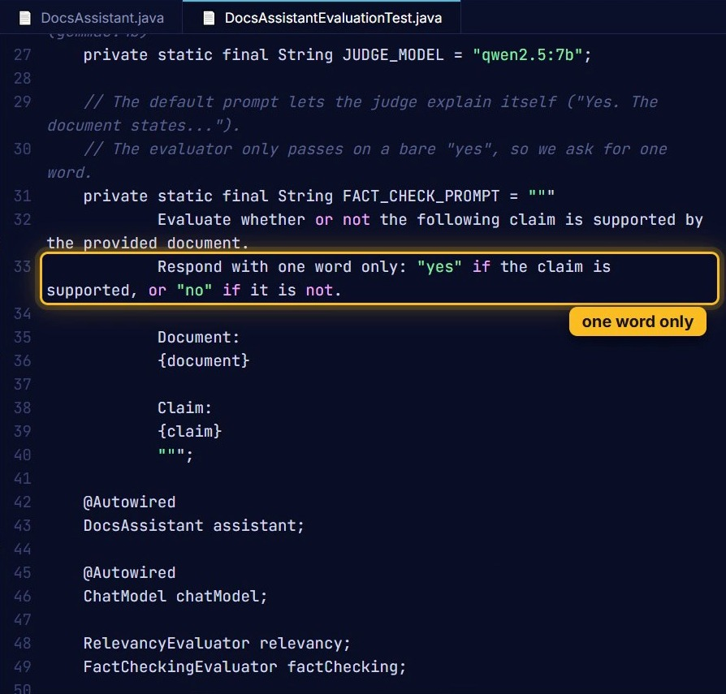

Run again. Eight tests, zero failures, in about three minutes. I ran it twice more: green both times.

```bash
$ ./mvnw test
...
Q: How many vacation days do full-time employees
   get? | A: Full-time employees get 27 vacation
   days per year.
Out of scope | A: I cannot answer the user query
   because the user query is outside my knowledge base.
...
Tests run: 8, Failures: 0, Errors: 0, Skipped: 0
BUILD SUCCESS
```

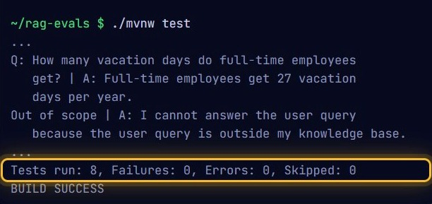

## 3 pro tips

Read what your judge says before you trust it. Log the raw verdict when a test fails.

Keep the golden set small and real: questions your users actually ask, with one fact each.

And run evals when you change the prompt, the model, or the chunking. Not on every commit: they're slow.

- **Read the judge**: Log the raw verdict
- **Small, real set**: Real questions, one fact each
- **Run on changes**: Prompt, model, chunking

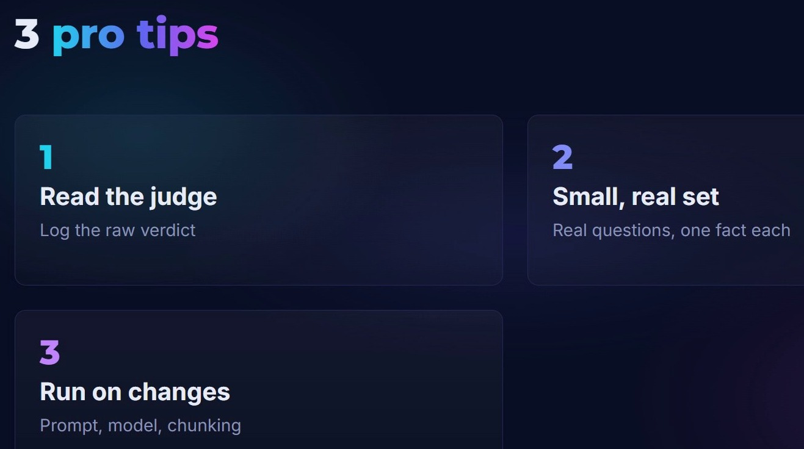

## Your challenge

Your challenge: add four questions to the golden set, including one with a tricky wording. Does the plain assertion still pass?

Then change the chunk size from 100 to 500 tokens, and run the evals. Better, or worse? Now you can measure it.

- **Grow the set**: 4 more questions, 1 tricky
- **Measure a change**: Chunk size 100 → 500: better?

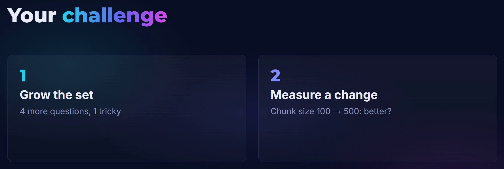

## Recap

- A **golden set**: plain assertions first
- **Another model** judges relevancy and facts
- Test the judge, and read its verdict

## Get the code and the quiz

- **Code for this lab**: https://github.com/NEDBS12/youtube-tuto/tree/main/spring-ai-course/labs/rag-evals
- **All course code, quizzes and resources**: https://github.com/NEDBS12/youtube-tuto/tree/main/spring-ai-course
- **Lesson quiz and section evals**: https://nedbs12.github.io/youtube-tuto/spring-ai-course/quiz/
- **Ollama**: https://ollama.com
- **Spring AI evaluation testing docs**: https://docs.spring.io/spring-ai/reference/api/testing.html
- **Spring AI reference docs**: https://docs.spring.io/spring-ai/reference/

🎥 **Watch the video tutorial:** {VIDEO_URL}

**Previous: Lesson 7.1, evaluating AI. Next: Lesson 7.2, observability.**

*The editor and terminal in the screenshots are a simplified recreation; the code and the outputs come from real runs of the lab.*

*I'm Zero Cost AI: I build AI tools and tutorials and share them for free. Follow me on Medium for the next lessons, and subscribe on YouTube: https://www.youtube.com/@zerocostai-f1h*
