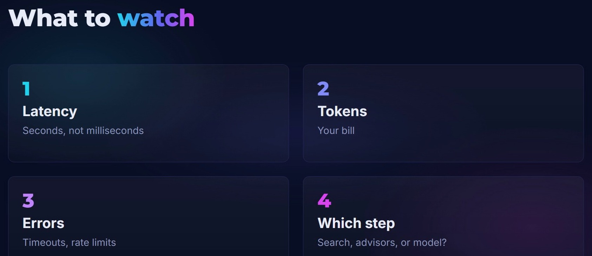
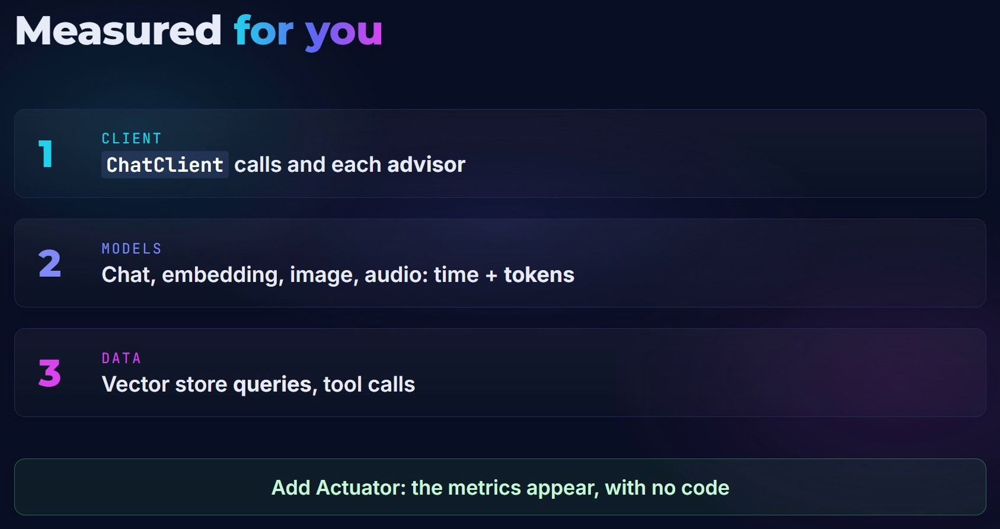
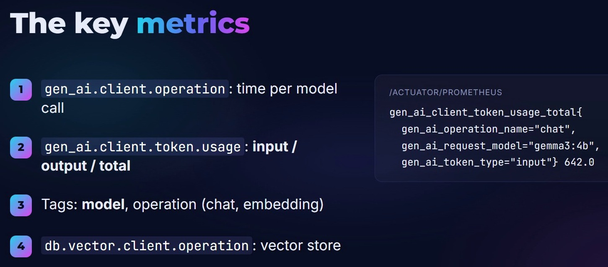
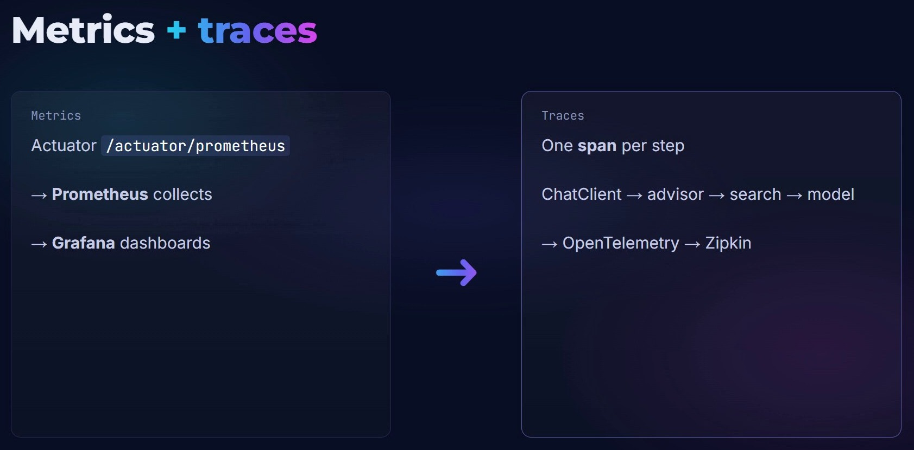
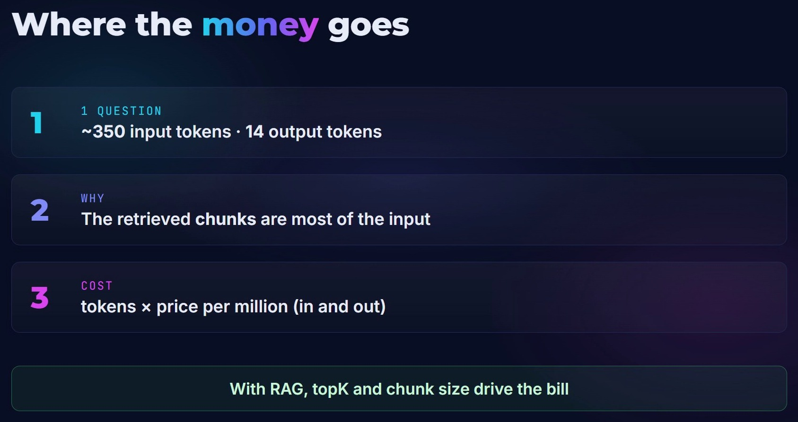
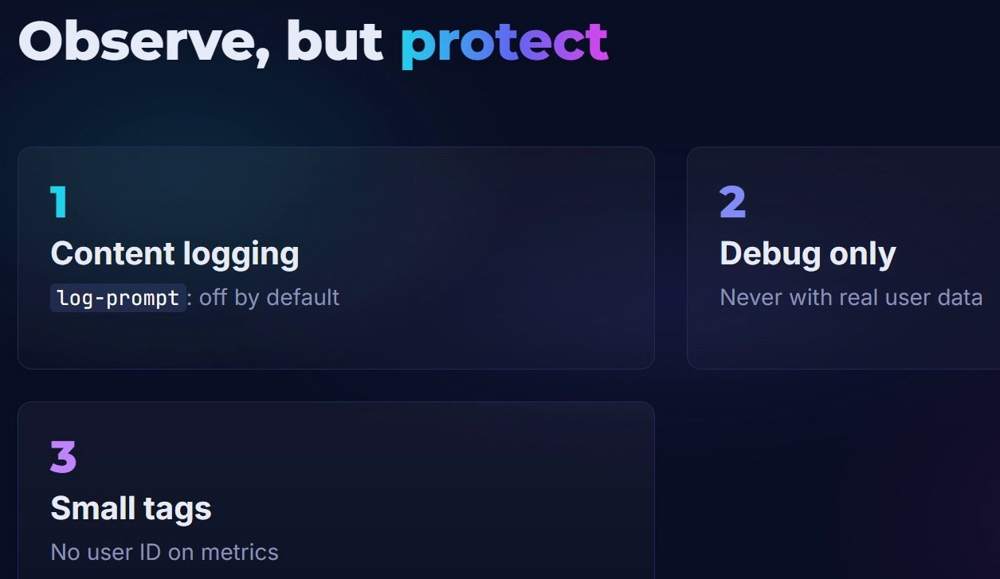

Your AI app is live. Users say it's slow. Your boss asks how much it costs. Can you answer, with numbers?

This is lesson 7.2: observability. Seeing what your AI app really does.

It's lesson 7.2 of my free **Spring AI: Novice to Expert** course, where every lesson has a concept part and a hands-on lab, and everything runs on a free local model with Ollama.

🎥 **Prefer video?** Watch the full tutorial here:

{VIDEO}

## What to watch

An AI app needs four numbers that a normal app doesn't care much about.

Latency. A model call takes seconds, not milliseconds. In our RAG app, the slowest chat call took almost 18 seconds.

Tokens. They are your bill, with a paid provider.

Errors: timeouts, rate limits, a model that's down.

And which step is slow: the vector search, the advisors, or the model?

- **Latency**: Seconds, not milliseconds
- **Tokens**: Your bill
- **Errors**: Timeouts, rate limits
- **Which step**: Search, advisors, or model?



## Measured for you

Good news: Spring AI measures all of this for you, with Micrometer, the standard Spring metrics library.

The ChatClient and every advisor are timed.

Every model call: chat, embedding, image and audio, with its token usage.

Vector store operations: add, delete, query. And tool calls.

You add Spring Boot Actuator, and the metrics are there. No code.

- **Client**: `ChatClient` calls and each **advisor**
- **Models**: Chat, embedding, image, audio: time + **tokens**
- **Data**: Vector store **queries**, tool calls

**Add Actuator: the metrics appear, with no code**



## The key metrics

The two metrics you'll use most.

`gen_ai.client.operation`: a timer for every model call.

`gen_ai.client.token.usage`: a counter, with a token type tag: input, output, or total.

Both are tagged with the model and the operation, so you can split by model, chat or embedding.

And for the vector store: `db.vector.client.operation`.

- `gen_ai.client.operation`: time per model call
- `gen_ai.client.token.usage`: **input / output / total**
- Tags: **model**, operation (chat, embedding)
- `db.vector.client.operation`: vector store

In code:

```java
gen_ai_client_token_usage_total{
  gen_ai_operation_name="chat",
  gen_ai_request_model="gemma3:4b",
  gen_ai_token_type="input"} 642.0
```



## Metrics + traces

Where do the numbers go?

Metrics: Actuator exposes them in the Prometheus format. Prometheus collects them, and Grafana draws the dashboards.

Traces: the same observations become spans: one per step. The ChatClient, the advisors, the vector search, the model. Export them with OpenTelemetry to a tool like Zipkin, and you see exactly which step is slow.

### Metrics

- Actuator `/actuator/prometheus`
- → **Prometheus** collects
- → **Grafana** dashboards

### Traces

- One **span** per step
- ChatClient → advisor → search → model
- → OpenTelemetry → Zipkin



## Where the money goes

Now cost. Here's a real number from our lab.

One RAG question: about 350 input tokens, and only 14 output tokens.

Why so many input tokens? The retrieved chunks. With RAG, the context is most of your bill.

Cost is just tokens times the price per million, for input and for output. Ollama is free, but you can still compute what a paid model would cost.

Fewer chunks, or smaller chunks, cost less.

- **1 question**: **~350** input tokens · **14** output tokens
- **Why**: The retrieved **chunks** are most of the input
- **Cost**: tokens × price per million (in and out)

**With RAG, topK and chunk size drive the bill**



## Observe, but protect

One warning: privacy.

Spring AI can log the full prompt and the completion. It's off by default, for a reason: prompts contain user data.

Turn it on only to debug, never in production with real users.

And keep tags small. A user ID as a metric tag creates one series per user. Put it in traces or logs instead.

- **Content logging**: `log-prompt`: off by default
- **Debug only**: Never with real user data
- **Small tags**: No user ID on metrics



## Recap

- Watch **latency, tokens, errors**, and which step is slow
- Spring AI measures it all with **Micrometer**: add Actuator
- Tokens × price = cost; keep prompts out of logs

## Quick quiz

Test yourself before you read the answers.

1. **Tokens**: Which metric counts input and output tokens?
2. **Setup**: What do you add to see Spring AI metrics?
3. **Cost**: In a RAG app, what makes most of the input tokens?

**Answers:**

1. `gen_ai.client.token.usage`
2. Spring Boot **Actuator** (+ a registry)
3. The **retrieved chunks**

The full five-question quiz for this lesson is free on the course quiz page: https://nedbs12.github.io/youtube-tuto/spring-ai-course/quiz/

## Get the code and the quiz

- **Lab code for this lesson**: https://github.com/NEDBS12/youtube-tuto/tree/main/spring-ai-course/labs/rag-observability
- **All course code, quizzes and resources**: https://github.com/NEDBS12/youtube-tuto/tree/main/spring-ai-course
- **Lesson quiz and section evals**: https://nedbs12.github.io/youtube-tuto/spring-ai-course/quiz/
- **Spring AI observability docs**: https://docs.spring.io/spring-ai/reference/observability/index.html
- **Spring AI reference docs**: https://docs.spring.io/spring-ai/reference/

🎥 **Watch the video tutorial:** {VIDEO_URL}

**Previous: Lab 7.1. Next: Lab 7.2, token metrics and a cost report.**

*I'm Zero Cost AI: I build AI tools and tutorials and share them for free. Follow me on Medium for the next lessons, and subscribe on YouTube: https://www.youtube.com/@zerocostai-f1h*
