We add observability to our RAG app: timers, token counters, and a cost report.

And it starts with almost no code.

It's lab 7.2 of my free **Spring AI: Novice to Expert** course, where every lesson has a concept part and a hands-on lab, and everything runs on a free local model with Ollama.

🎥 **Prefer video?** Watch the full tutorial here:

{VIDEO}

## What we'll build

Add Actuator. Find the Spring AI metrics. Read the token counters. Tokens on every answer. And a cost report.

1. **Actuator**: 2 dependencies, 1 property
2. **Find the metrics**: What Spring AI records
3. **Read the counters**: Tokens and timers
4. **Tokens per answer**: From the response metadata
5. **A cost report**: Tokens × price

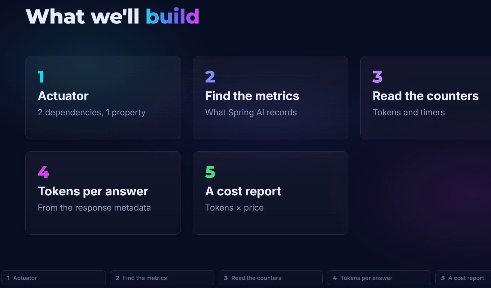

## Step 1: Actuator

We start from the RAG app of lab 7.1. Two dependencies: the Actuator starter, and the Micrometer registry for Prometheus.

**pom.xml · two new dependencies**

- **spring-boot-starter-actuator**: metrics endpoints
- **micrometer-registry-prometheus**: /actuator/prometheus

And one property, to expose the health, metrics and Prometheus endpoints. That's all. No Spring AI code.

**`application.properties`** (`src/main/resources/application.properties`):

```properties
spring.application.name=rag-observability
spring.ai.ollama.chat.model=gemma3:4b
spring.ai.ollama.embedding.model=mxbai-embed-large
spring.ai.vectorstore.pgvector.initialize-schema=true
spring.ai.vectorstore.pgvector.dimensions=1024
```

**`application.properties`** (continued):

```properties
management.endpoints.web.exposure.include=health,metrics,prometheus
```

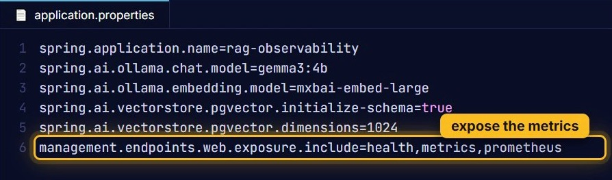

## Step 2: Find the metrics

I start the app, and ask one question, so there's something to measure.

```bash
$ ./mvnw spring-boot:run
...
Started DocsChatApplication in 5.1 seconds
```

```bash
$ curl "localhost:8080/ask?q=How+many+vacation+days+do+I+get%3F"
...
```

Now the list of metrics, filtered on the AI ones. Model calls, tokens, the ChatClient, the advisors, and the vector store. All recorded, with zero code.

```bash
$ curl -s localhost:8080/actuator/metrics | jq '.names[]' | grep -E 'gen_ai|spring.ai|db.vector'
"db.vector.client.operation"
"db.vector.client.operation.active"
"gen_ai.client.operation"
"gen_ai.client.operation.active"
"gen_ai.client.token.usage"
"spring.ai.advisor"
"spring.ai.advisor.active"
"spring.ai.chat.client"
"spring.ai.chat.client.active"
```

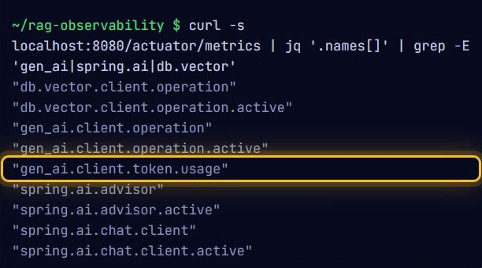

## Step 3: Read the counters

The Prometheus endpoint shows the token counter, split by model and by type. 642 input tokens, 43 output, after three questions. And 29 for the embeddings.

```bash
$ curl -s localhost:8080/actuator/prometheus | grep ^gen_ai_client_token
gen_ai_client_token_usage_total{
 gen_ai_operation_name="chat",
 gen_ai_request_model="gemma3:4b",
 gen_ai_token_type="input"} 642.0
gen_ai_client_token_usage_total{...
 gen_ai_token_type="output"} 43.0
gen_ai_client_token_usage_total{
 gen_ai_operation_name="embedding",
 gen_ai_response_model="mxbai-embed-large",
 gen_ai_token_type="input"} 29.0
```

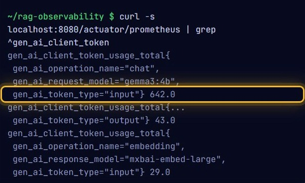

And the timer for the chat calls: three calls, 4.3 seconds in total, the slowest one, 1.7.

```bash
$ curl -s "localhost:8080/actuator/metrics/gen_ai.client.operation?tag=gen_ai.operation.name:chat"
{"name":"gen_ai.client.operation",
 "baseUnit":"seconds","measurements":[
  {"statistic":"COUNT","value":3.0},
  {"statistic":"TOTAL_TIME","value":4.297},
  {"statistic":"MAX","value":1.73}], ...}
```

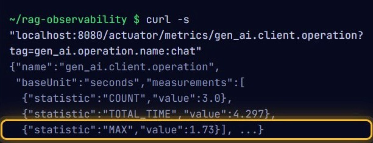

Prometheus can scrape this endpoint every few seconds, and Grafana can draw it. Same data, nicer charts.

## Step 4: Tokens per answer

Totals are good, but I also want the cost of each question. Every chat response carries a Usage object in its metadata.

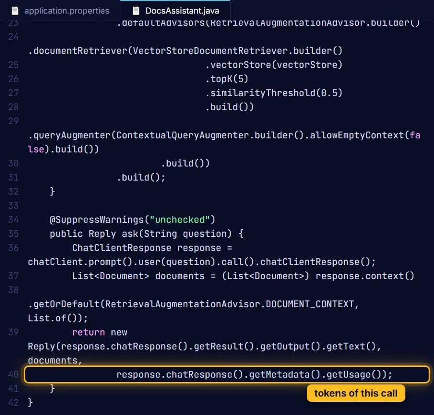

The Reply record keeps it, and the controller returns the input and output tokens with the answer.

**`ChatController.java`** (`src/main/java/dev/course/docs/ChatController.java`):

```java
package dev.course.docs;

import java.util.Map;

import org.springframework.web.bind.annotation.GetMapping;
import org.springframework.web.bind.annotation.RequestParam;
import org.springframework.web.bind.annotation.RestController;

@RestController
public class ChatController {

    private final DocsAssistant assistant;

    public ChatController(DocsAssistant assistant) {
        this.assistant = assistant;
    }

    @GetMapping("/ask")
    public Map<String, Object> ask(@RequestParam String q) {
        Reply reply = assistant.ask(q);
        return Map.of("answer", reply.answer(), "sources", reply.sources(),
                "tokens", Map.of("input", reply.usage().getPromptTokens(), "output", reply.usage().getCompletionTokens()));
    }
}
```

Look: 352 tokens in, 14 out. The retrieved chunks are most of the input.

```bash
$ curl "localhost:8080/ask?q=How+many+vacation+days+do+I+get%3F"
{"tokens":{"output":14,"input":352},
 "sources":["employee-handbook.pdf 3",
  "employee-handbook.pdf 2"],
 "answer":"Full-time employees get 27 vacation
  days per year."}
```

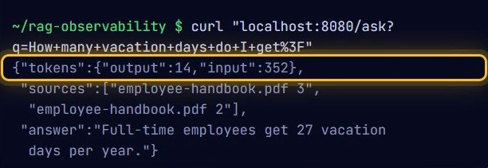

A question outside the documents: 55 tokens in. No chunks were found, so the prompt is small.

```bash
$ curl "localhost:8080/ask?q=What+is+the+capital+of+Australia%3F"
{"tokens":{"output":17,"input":55},"sources":[],
 "answer":"I cannot answer the user query because
  the user query is outside my knowledge base."}
```

## Step 5: A cost report

The UsageController gets the MeterRegistry, the place where Micrometer keeps every metric.

**`UsageController.java`**:

```java
package dev.course.docs;

import java.util.Map;

import io.micrometer.core.instrument.Counter;
import io.micrometer.core.instrument.MeterRegistry;
import org.springframework.beans.factory.annotation.Value;
import org.springframework.web.bind.annotation.GetMapping;
import org.springframework.web.bind.annotation.RestController;

/** Reads the token counters Spring AI records, and turns them into a cost. */
@RestController
public class UsageController {

    private final MeterRegistry registry;

    // Ollama is free: these are example prices, to see what a paid model would cost
    @Value("${app.price.input-per-million:0.40}")
    double inputPrice;

    @Value("${app.price.output-per-million:1.60}")
    double outputPrice;

    public UsageController(MeterRegistry registry) {
        this.registry = registry;
    }

    @GetMapping("/usage")
    public Map<String, Object> usage() {
        double input = tokens("chat", "input");
        double output = tokens("chat", "output");
        double cost = (input * inputPrice + output * outputPrice) / 1_000_000;
        return Map.of(
                "chatInputTokens", (long) input,
                "chatOutputTokens", (long) output,
                "embeddingTokens", (long) tokens("embedding", "input"),
                "estimatedCostUsd", "%.6f".formatted(cost));
    }
```

The tokens method finds the token counter, for one operation and one type, and adds up the counts. Then cost is tokens times the price per million.

**`UsageController.java`** (continued):

```java
    private double tokens(String operation, String type) {
        return registry.find("gen_ai.client.token.usage")
                .tag("gen_ai.operation.name", operation)
                .tag("gen_ai.token.type", type)
                .counters().stream()
                .mapToDouble(Counter::count)
                .sum();
    }
}
```

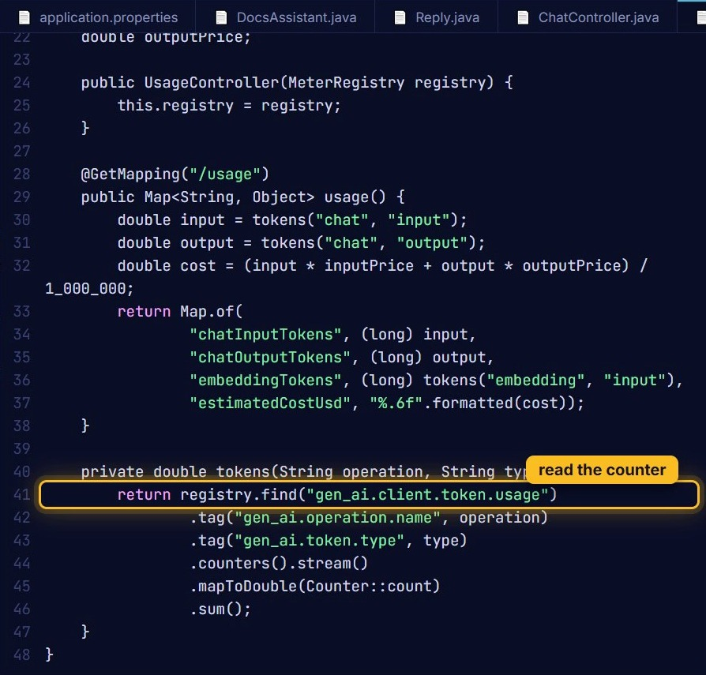

Ollama is free, so the prices are examples, in the properties. Set your provider's real prices.

**`application.properties`** (continued):

```properties
# example prices per million tokens, used by /usage
app.price.input-per-million=0.40
app.price.output-per-million=1.60
```

After three questions: 642 tokens in, 43 out. With these prices, a third of a tenth of a cent. Now you can multiply by your users.

```bash
$ curl localhost:8080/usage
{"chatOutputTokens":43,"embeddingTokens":29,
 "estimatedCostUsd":"0.000326",
 "chatInputTokens":642}
```

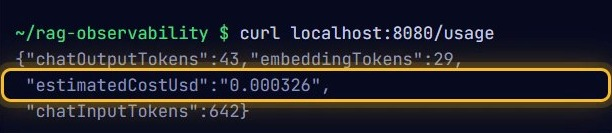

## 3 pro tips

Watch input tokens first. With RAG, topK and chunk size are your biggest cost levers.

Alert on latency, not only errors. A model that's slow is down, for your users.

And for traces, add Micrometer tracing with an OpenTelemetry exporter. Each advisor and model call becomes a span.

- **Input tokens**: topK and chunk size = cost
- **Alert on latency**: Slow is down, for users
- **Add tracing**: One span per step

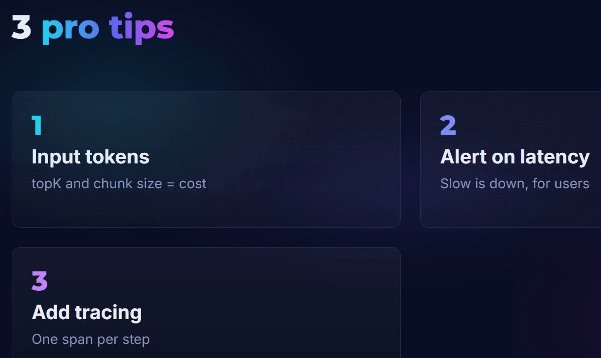

## Your challenge

Your challenge: add the cost per question to the ask response, using the usage and the prices.

Then change topK from five to two, ask the same questions, and compare the input tokens. How much did you save? And are the answers still right?

- **Cost per answer**: Usage × prices, in /ask
- **topK 5 → 2**: Tokens saved? Answers still right?

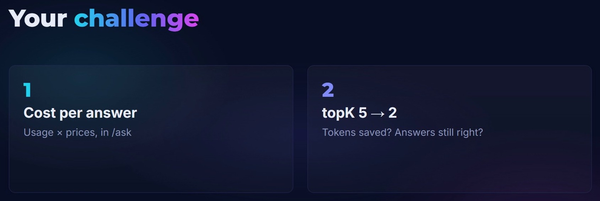

## Recap

- Actuator + a registry: the AI metrics **appear**
- `gen_ai.client.token.usage` counts **input and output**
- Usage per answer, and tokens × price = cost

## Get the code and the quiz

- **Code for this lab**: https://github.com/NEDBS12/youtube-tuto/tree/main/spring-ai-course/labs/rag-observability
- **All course code, quizzes and resources**: https://github.com/NEDBS12/youtube-tuto/tree/main/spring-ai-course
- **Lesson quiz and section evals**: https://nedbs12.github.io/youtube-tuto/spring-ai-course/quiz/
- **Ollama**: https://ollama.com
- **Spring AI observability docs**: https://docs.spring.io/spring-ai/reference/observability/index.html
- **Spring AI reference docs**: https://docs.spring.io/spring-ai/reference/

🎥 **Watch the video tutorial:** {VIDEO_URL}

**Previous: Lesson 7.2, observability. Next: Lesson 7.3, guardrails.**

*The editor and terminal in the screenshots are a simplified recreation; the code and the outputs come from real runs of the lab.*

*I'm Zero Cost AI: I build AI tools and tutorials and share them for free. Follow me on Medium for the next lessons, and subscribe on YouTube: https://www.youtube.com/@zerocostai-f1h*
